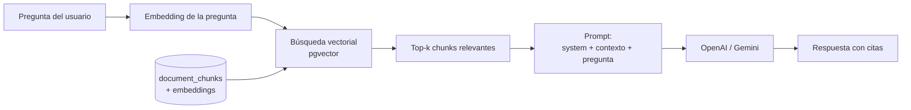
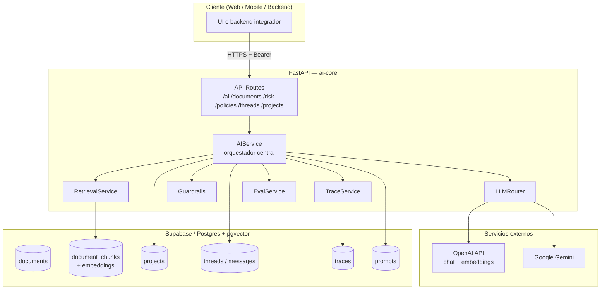

# ai-core — Demo de portafolio: RAG normativo

> **RAG** (*Retrieval-Augmented Generation*) sobre gobernanza de IA — **FastAPI + OpenAI + Supabase (pgvector)**.
> Repositorio de portafolio: superficie HTTP mínima (`/health`, `/ai/query`); el dominio completo vive en `app/domain/`.

**English (default on GitHub):** [`README.md`](README.md).

---

## Tabla de contenidos

- [Acerca de este repositorio (portafolio)](#acerca-de-este-repositorio-portafolio) · [README en inglés](README.md)
- [Descripción del proyecto](#descripción-del-proyecto)
- [Problema que resuelve](#problema-que-resuelve)
- [¿Qué es RAG? Explicación simple](#qué-es-rag-explicación-simple)
- [Stack tecnológico](#stack-tecnológico)
- [Arquitectura general](#arquitectura-general)
- [Quickstart paso a paso](#quickstart-paso-a-paso)
- [Demo rápida (portfolio)](#demo-rápida-portfolio)
- [Cómo correr con Docker](#cómo-correr-con-docker)
- [Ejemplo de uso del API](#ejemplo-de-uso-del-api)
- [Estructura del proyecto (resumen)](#estructura-del-proyecto-resumen)
- [Documentación detallada (`/docs`)](#documentación-detallada-docs)

---

## Acerca de este repositorio (portafolio)

Este proyecto forma parte de mi **portafolio profesional**. El objetivo no es presentar un producto comercial terminado, sino **demostrar que sé diseñar e implementar sistemas RAG** en un dominio exigente: **normativa y gobernanza de IA** (por ejemplo ISO/IEC 42001).

### Idioma del proyecto

El **README principal del repositorio está en inglés** ([`README.md`](README.md)) para revisores internacionales. **Este archivo** (`README.es.md`) y el notebook de demo usan **español** porque **la mayoría del corpus RAG** (PDFs normativos, contexto regional, etc.) está en español. El código del backend sigue convenciones en **inglés** (módulos, campos de la API). Los embeddings son multilingües, pero la demo prioriza preguntas en español alineadas con los documentos.

### Propósito

Mostrar de forma concreta:

- **Pipeline RAG end-to-end**: chunking, embeddings, búsqueda vectorial (pgvector), ensamblaje de contexto y generación con LLM.
- **API lista para demo**: FastAPI, contrato en `POST /ai/query`, configuración vía `.env`, errores claros cuando falla un proveedor externo.
- **Ingeniería en capas**: `api` → `domain` → `db`, aislamiento por `tenant_id`, guardrails y trazas en backend.

La **superficie HTTP activa** está reducida a la demo: `GET /health` y `POST /ai/query` (ver [`app/main.py`](app/main.py)). Módulos adicionales (documentos, riesgo, políticas, evals, etc.) siguen en el código como **evidencia de diseño**; no hace falta exponerlos en Swagger para evaluar la demo.

### Cómo leer este repositorio

| Si quieres ver… | Empieza aquí |
|---|---|
| **Demo en pocos minutos** | [Demo rápida (portfolio)](#demo-rápida-portfolio) y [`notebooks/ai_query_test.ipynb`](notebooks/ai_query_test.ipynb) |
| **Flujo de una pregunta** | [`app/api/routes/ai.py`](app/api/routes/ai.py) → [`app/domain/ai_service.py`](app/domain/ai_service.py) → [`app/domain/retrieval/service.py`](app/domain/retrieval/service.py) → [`app/domain/llm/`](app/domain/llm/) |
| **Contrato HTTP** | [`app/schemas/ai.py`](app/schemas/ai.py) |
| **Secretos y config** | [`.env.example`](.env.example) (nunca subas `.env`; ver [`.gitignore`](.gitignore)) |
| **Corpus inicial** | [`scripts/seed_prompts.py`](scripts/seed_prompts.py), [`scripts/seed_documents.py`](scripts/seed_documents.py) |
| **Tests del endpoint central** | [`app/tests/test_ai.py`](app/tests/test_ai.py) |

**Evaluación rápida:** levanta la API, ejecuta el notebook o Swagger con preguntas ISO 42001. **Evaluación profunda:** recorre `app/domain/` y las migraciones en `app/db/migrations/`.

### Qué demuestra sobre RAG

1. La consulta se **embebe** y se recuperan chunks con filtros (tenant, país, framework).
2. Los chunks entran al **prompt** junto con system prompts versionados.
3. El LLM responde **anclado al contexto recuperado**, no solo a conocimiento paramétrico.
4. El backend soporta **trazabilidad y evaluación**; el notebook de portafolio imprime solo `response_text`.

### Limitaciones (contexto honesto)

- Autenticación stub en desarrollo (`Bearer dev-token`).
- `.env`, carpeta `docs/` (corpus local) y `.venv` **no se publican** (`.gitignore`).
- Demo **local**: requiere Supabase + OpenAI; no es un despliegue SaaS.

> **En una frase:** case study de **RAG regulado** — corre la demo, luego profundiza en `app/domain/` si te interesa la arquitectura.

---

## Descripción del proyecto

`ai-core` es un **motor de IA centralizado** para aplicaciones SaaS multi-tenant
enfocado en la **gobernanza de proyectos de Inteligencia Artificial**. Expone una
API REST (FastAPI) que ofrece:

1. **Ingesta documental** (PDF, DOCX, TXT) con tagging por país y por marco
   normativo (ISO 42001, NIST AI RMF, OWASP LLM Top 10, GDPR, EU AI Act,
   MITRE ATLAS, PCI, etc.).
2. **Búsqueda semántica (RAG)** sobre la base de conocimiento, con filtros por
   tenant, país y framework.
3. **Asistente conversacional** con memoria multi-capa (sesión, proyecto,
   razonamiento previo).
4. **Orquestadores estructurados** para riesgo, generación de políticas y
   generación de controles.
5. **Trazabilidad completa**: cada llamada al LLM se registra para auditoría,
   evaluación y fine-tuning posterior.
6. **Guardrails** anti-inyección de prompts y reglas de seguridad obligatorias.

Toda la lógica vive bajo el principio de **un único motor por tenant**: los
documentos, conversaciones y proyectos están aislados a nivel de aplicación
(`tenant_id`) y la biblioteca normativa global (`tenant_id="global"`) es
compartida por todos.

---

## Problema que resuelve

Implementar un **Sistema de Gestión de IA** alineado con marcos como ISO/IEC
42001 y NIST AI RMF normalmente exige:

- Leer y entender cientos de páginas de normativa.
- Identificar qué controles aplican a cada proyecto de IA.
- Documentar riesgos, políticas y controles con trazabilidad regulatoria.
- Mantener todo actualizado conforme cambian las leyes (EU AI Act, leyes
  locales de protección de datos, etc.).

`ai-core` resuelve esto convirtiendo la normativa en **conocimiento consultable
por LLM con citas verificables**, y guiando al equipo a través de flujos
estructurados (intake de proyecto → análisis de riesgos → política → controles)
que el modelo puede justificar después con evidencia documental.

> **En una frase:** convierte documentos regulatorios estáticos en un copiloto
> de gobernanza de IA con memoria, citas y workflows guiados.

---

## ¿Qué es RAG? Explicación simple

**RAG** (*Retrieval-Augmented Generation*) es la técnica que combina **búsqueda
semántica** con **generación de texto por LLM**. La idea base:

1. **Indexación previa.** Cada documento se trocea en *chunks*, cada chunk se
   convierte en un vector numérico (*embedding*) que captura su significado, y
   se guarda en una base vectorial.
2. **Recuperación.** Cuando el usuario pregunta algo, su consulta también se
   convierte en vector y se buscan los chunks más cercanos por similitud
   coseno.
3. **Generación.** Esos chunks se inyectan al prompt del LLM como contexto, y
   el LLM responde **basándose en ese contexto**, no en su memoria de
   entrenamiento.



**¿Por qué importa?** Sin RAG, un LLM solo sabe lo que aprendió durante su
entrenamiento. Con RAG puede contestar sobre **tus** documentos, **tus**
políticas y **tu** normativa, citando las fuentes exactas.

Detalles completos del pipeline en [`docs/rag/full_pipeline.md`](docs/rag/full_pipeline.md).

---

## Stack tecnológico

| Capa | Tecnología | Por qué |
|---|---|---|
| **API** | FastAPI 0.111+ | Async-ready, validación con Pydantic, OpenAPI auto-generado |
| **LLM** | OpenAI (GPT-4o / GPT-4o-mini) | Calidad y latencia óptimas para Q&A regulatorio |
| **LLM alternativo** | Google Gemini (1.5 / 2.0) | Provider de respaldo intercambiable vía router |
| **Embeddings** | OpenAI `text-embedding-3-small` (1536 dims) | Costo bajo, calidad suficiente para multi-idioma |
| **Vector store** | Supabase + `pgvector` (ivfflat, cosine) | Postgres administrado, no hace falta una vector DB aparte |
| **Persistencia** | Supabase (PostgreSQL 16) | Auth + Storage + DB en un solo backend |
| **Configuración** | Pydantic Settings + `.env` | Tipado fuerte, validación al arranque |
| **Containerización** | Docker (multi-stage) + docker-compose | Imagen reproducible y Postgres local con pgvector |
| **Testing** | pytest + pytest-asyncio + httpx TestClient | Tests unitarios + integración end-to-end |
| **Parsing** | pypdf, python-docx, pytesseract (fallback OCR) | Cubre los formatos más comunes |

> **Nota sobre runtime:** Python 3.11. La imagen Docker es `python:3.11-slim`.

---

## Arquitectura general



---

## Quickstart paso a paso

### 1. Pre-requisitos

- **Python 3.11**
- **Cuenta de Supabase** (https://supabase.com) con un proyecto creado
- **OpenAI API Key** (https://platform.openai.com/api-keys)
- **Docker** (opcional, para Postgres local con pgvector)

### 2. Clonar e instalar dependencias

```bash
git clone <url-del-repo> llm_ai_governance_project
cd llm_ai_governance_project

python3.11 -m venv .venv
source .venv/bin/activate
pip install --upgrade pip
pip install -r requirements.txt
```

### 3. Configurar variables de entorno

```bash
cp .env.example .env
```

Edita `.env` y rellena los valores. **Nunca subas este archivo a git.**

```env
# Supabase
SUPABASE_URL=https://tu-proyecto.supabase.co
SUPABASE_SERVICE_KEY=YOUR_SUPABASE_SERVICE_KEY

# OpenAI
OPENAI_API_KEY=YOUR_OPENAI_API_KEY

# (Opcional) Gemini
GEMINI_API_KEY=YOUR_GEMINI_API_KEY

# Router por defecto
LLM_DEFAULT_PROVIDER=openai
LLM_DEFAULT_MODEL=gpt-4o-mini
EMBEDDING_MODEL=text-embedding-3-small
```

> **Importante:** `SUPABASE_SERVICE_KEY` es la *service role key* — tiene
> acceso completo a la base de datos y **omite Row Level Security**. Nunca la
> expongas en el frontend.

### 4. Crear el esquema en Supabase

Desde el SQL Editor de Supabase, ejecuta en orden:

1. `app/db/migrations/001_initial.sql` — tablas base + pgvector
2. `app/db/migrations/002_add_country.sql` — soporte de país
3. `app/db/migrations/003_fix_ivfflat_probes.sql` — ajustes de índice
4. `app/db/migrations/004_projects_memory_framework.sql` — proyectos, threads,
   filtro por framework

> Si tu proyecto Supabase muestra el aviso *“New tables will not have Row Level
> Security enabled”*, en desarrollo puedes hacer click en **Run anyway**. Para
> producción ver [`docs/decisions/tradeoffs.md`](docs/decisions/tradeoffs.md).

### 5. Sembrar prompts y documentos normativos

```bash
# Carga los system prompts versionados (chatbot, risk_intake, policy, etc.)
PYTHONPATH=. python scripts/seed_prompts.py

# Carga los documentos normativos desde docs/admin/<Framework>/<País>/...
PYTHONPATH=. python scripts/seed_documents.py
```

`seed_documents.py` es **idempotente**: documentos `ready` se omiten salvo que
pases `--force`.

### 6. Levantar el servidor

```bash
uvicorn app.main:app --reload
```

- API base: `http://localhost:8000`
- Swagger UI: `http://localhost:8000/docs`
- Redoc: `http://localhost:8000/redoc`

### 7. Probar el endpoint principal

```bash
curl -X POST http://localhost:8000/ai/query \
  -H "Content-Type: application/json" \
  -H "Authorization: Bearer dev-token" \
  -d '{
    "query": "¿Qué requiere ISO 42001 sobre el comité de gobernanza de IA?",
    "use_case": "chatbot",
    "framework_filter": ["iso_42001"]
  }'
```

> El sistema acepta cualquier token en desarrollo (auth está stubbed). Ver
> [`docs/decisions/design_choices.md`](docs/decisions/design_choices.md).

---

## Demo rápida (portfolio)

Superficie HTTP mínima para mostrar RAG normativo: solo **`GET /health`** y
**`POST /ai/query`** (ver [`app/main.py`](app/main.py)). El resto del dominio
(documentos, riesgo, políticas, etc.) permanece en el código como referencia de
diseño, pero no aparece en Swagger.

1. **`.env`** — Supabase + `OPENAI_API_KEY` válida (evita `export OPENAI_API_KEY`
   en el shell si quieres que mande el valor del archivo).
2. **Seeds** — pasos 4–5 del quickstart (migraciones, `seed_prompts`, `seed_documents`).
3. **Servidor** — `uvicorn app.main:app --reload`.
4. **Probar** — notebook [`notebooks/ai_query_test.ipynb`](notebooks/ai_query_test.ipynb)
   (cinco preguntas ISO 42001, solo texto de respuesta) **o** Swagger en `/docs`.

Body de ejemplo en Swagger (**no** envíes `thread_id` / `project_id` con UUIDs
de ejemplo):

```json
{
  "query": "¿Qué es ISO/IEC 42001 y para qué sirve?",
  "use_case": "chatbot",
  "framework_filter": ["iso_42001"],
  "country": "costa-rica",
  "include_global": true
}
```

Header: `Authorization: Bearer dev-token`.

---

## Cómo correr con Docker

### Opción A — Solo Postgres con pgvector (recomendado para desarrollo)

```bash
docker compose up -d postgres
```

Esto levanta `pgvector/pgvector:pg16` en `localhost:5432`. Útil si prefieres
trabajar contra una DB local en lugar de Supabase Cloud.

### Opción B — App completa en contenedor

Construye la imagen multi-stage:

```bash
docker build -t aicore .
```

Y córrela montando tu `.env`:

```bash
docker run -p 8000:8000 --env-file .env aicore
```

La imagen final pesa poco porque el `Dockerfile` usa **multi-stage build**
(stage `builder` con dependencias + stage `runtime` mínimo).

Detalles completos en [`docs/docker_deployment.md`](docs/docker_deployment.md).

---

## Ejemplo de uso del API

### Subir un documento

```bash
curl -X POST http://localhost:8000/documents/upload \
  -H "Authorization: Bearer dev-token" \
  -F "file=@./mi_politica.pdf" \
  -F "country=costa-rica"
```

Respuesta:

```json
{
  "id": "8f2c...",
  "filename": "mi_politica.pdf",
  "status": "pending",
  "country": "costa-rica"
}
```

### Procesarlo (parse + chunk + embed)

```bash
curl -X POST http://localhost:8000/documents/8f2c.../process \
  -H "Authorization: Bearer dev-token"
```

### Hacer una consulta RAG

```python
import requests

resp = requests.post(
    "http://localhost:8000/ai/query",
    headers={"Authorization": "Bearer dev-token"},
    json={
        "query": "¿Qué controles ISO 42001 aplican a un sistema generativo público?",
        "use_case": "chatbot",
        "framework_filter": ["iso_42001"],
        "top_k": 5,
        "response_mode": "structured",
    },
).json()

print(resp["response_text"])
print("Trace:", resp["trace_id"])
print("Chunks usados:", resp["retrieved_chunk_count"])
```

Respuesta abreviada:

```json
{
  "response_text": "{ \"answer\": \"...\", \"citations\": [...], \"confidence\": \"high\" }",
  "trace_id": "1d4a...",
  "thread_id": "9b81...",
  "model_provider": "openai",
  "model_name": "gpt-4o-mini",
  "latency_ms": 1840,
  "use_case": "chatbot",
  "retrieved_chunk_count": 5,
  "retrieved_chunks": [
    { "chunk_id": "...", "document_id": "...", "similarity": 0.876, "content_preview": "..." }
  ],
  "used_reasoning_memory": false
}
```

Ver el catálogo completo en [`docs/api/`](docs/api/) y la guía de integración
en [`docs/api/integration_guide.md`](docs/api/integration_guide.md).

---

## Estructura del proyecto (resumen)

```
llm_ai_governance_project/
├── app/
│   ├── main.py                  # Punto de entrada FastAPI
│   ├── core/                    # config, security, errors, logging
│   ├── api/
│   │   ├── deps.py              # Inyección de dependencias (auth, db)
│   │   └── routes/              # 9 routers: ai, documents, risk, policies...
│   ├── domain/                  # Lógica de negocio por dominio
│   │   ├── ai_service.py        # Orquestador central
│   │   ├── retrieval/           # RAG: embeddings + búsqueda + ranking
│   │   ├── documents/           # Ingesta, parsing, chunking
│   │   ├── llm/                 # Router OpenAI/Gemini + guardrails
│   │   ├── projects/            # Memoria L2 (expediente del proyecto)
│   │   ├── threads/             # Memoria L1 (conversación)
│   │   ├── risk/                # Orquestador de análisis de riesgo
│   │   ├── policies/            # Orquestador de políticas + controles
│   │   ├── prompts/             # Biblioteca de system prompts versionados
│   │   ├── traces/              # Auditoría de cada llamada al LLM
│   │   └── evals/               # Evaluación heurística automática
│   ├── schemas/                 # Pydantic schemas de la API
│   ├── db/
│   │   ├── supabase.py          # Cliente singleton
│   │   └── migrations/          # SQL versionados (001..004)
│   └── tests/                   # pytest
├── scripts/
│   ├── seed_documents.py        # Carga masiva docs/admin/
│   ├── seed_prompts.py          # Carga prompts versionados
│   ├── backfill_embeddings.py   # Re-genera embeddings
│   └── export_finetune_data.py  # Exporta dataset desde traces
├── docs/
│   ├── admin/                   # Corpus normativo (no commiteable)
│   ├── api/                     # Documentación de endpoints
│   ├── rag/                     # Pipeline RAG en profundidad
│   ├── decisions/               # ADRs y trade-offs
│   ├── docker_deployment.md
│   ├── testing.md
│   └── project_structure.md
├── notebooks/
│   └── ai_query_test.ipynb      # Demo: 5 queries ISO 42001
├── Dockerfile                   # Multi-stage: builder + runtime
├── docker-compose.yml           # Postgres + pgvector local
├── requirements.txt
├── .env.example
├── README.md                    # English (default)
└── README.es.md                 # ← estás aquí
```

En clones locales con carpeta `docs/` presente, el detalle está en
`docs/project_structure.md` (esa carpeta **no se sube al remoto**; ver `.gitignore`).

---

## Documentación detallada (`/docs`)

> La carpeta `docs/` (corpus normativo en `docs/admin/`, guías internas, ADRs) está en
> [`.gitignore`](.gitignore) y **no forma parte del repositorio público**. Para la demo
> basta este README, el notebook y el código en `app/`. Si tienes `docs/` en local, puedes
> usar la tabla siguiente como índice.

| Archivo | Contenido |
|---|---|
| [`docs/api/`](docs/api/) | Documentación por endpoint (request/response, ejemplos curl/Python/JS, errores) |
| [`docs/api/integration_guide.md`](docs/api/integration_guide.md) | Guía paso a paso para integrar `ai-core` desde otro backend, frontend o chatbot |
| [`docs/rag/full_pipeline.md`](docs/rag/full_pipeline.md) | Pipeline RAG en profundidad: ingesta → chunking → embeddings → retrieval → generación |
| [`docs/testing.md`](docs/testing.md) | Cómo testear, cómo validar la calidad del retrieval, cómo debuggear malas respuestas / hallucinations |
| [`docs/docker_deployment.md`](docs/docker_deployment.md) | Build, run, variables de entorno, escalabilidad |
| [`docs/project_structure.md`](docs/project_structure.md) | Cada carpeta y archivo importante explicado |
| [`docs/decisions/design_choices.md`](docs/decisions/design_choices.md) | Decisiones de arquitectura y por qué |
| [`docs/decisions/tradeoffs.md`](docs/decisions/tradeoffs.md) | Compromisos asumidos, pros y contras, alternativas evaluadas |

---

## Licencia

Código de portafolio — revisa el remoto o contacta al autor para condiciones de uso.

---

## Créditos

Proyecto de portafolio: RAG aplicado a gobernanza de IA (ISO/IEC 42001 y marcos
afines como contexto normativo del corpus).
