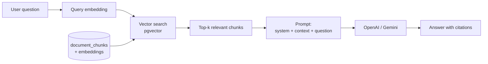
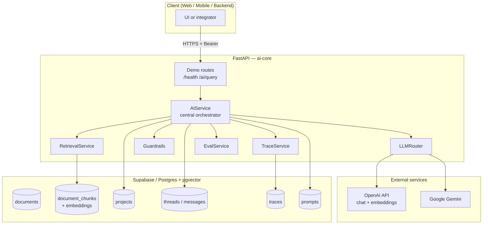

# ai-core — Portfolio demo: regulatory RAG

> **RAG** (*Retrieval-Augmented Generation*) for AI governance — **FastAPI + OpenAI + Supabase (pgvector)**.  
> Portfolio repo: minimal HTTP surface (`/health`, `/ai/query`); full domain logic lives under `app/domain/`.

**Español:** [`README.es.md`](README.es.md).

---

## Table of contents

- [About this repository (portfolio)](#about-this-repository-portfolio)
- [Project description](#project-description)
- [Problem context](#problem-context)
- [What is RAG?](#what-is-rag-a-simple-explanation)
- [Tech stack](#tech-stack)
- [Architecture overview](#architecture-overview)
- [Quickstart](#quickstart-step-by-step)
- [Quick demo (portfolio)](#quick-demo-portfolio)
- [Running with Docker](#running-with-docker)
- [API usage example](#api-usage-example)
- [Project structure (summary)](#project-structure-summary)
- [Extended documentation (`docs/`)](#extended-documentation-docs)
- [License](#license)
- [Credits](#credits)

---

## About this repository (portfolio)

This project is part of my **professional portfolio**. The goal is not to ship a commercial product, but to **demonstrate that I can design and implement RAG systems** in a demanding domain: **AI regulation and governance** (e.g. ISO/IEC 42001).

### Language of the project

The **default README is in English** (this file). A full **[Spanish README](README.es.md)** is available for local readers.

The **demo notebook** and **sample queries** are mostly in **Spanish** because **most documents used to feed the RAG pipeline** (regulatory PDFs, regional context, etc.) are in Spanish. Backend code follows usual **English** conventions (module names, API fields). Embeddings are multilingual (`text-embedding-3-small`), but the portfolio demo is **Spanish-first** for questions and answers to match the seeded corpus.

### Purpose

Demonstrate:

- **End-to-end RAG**: chunking, embeddings, vector search (pgvector), context assembly, LLM generation.
- **Demo-ready API**: FastAPI, `POST /ai/query` contract, `.env` configuration, clear errors when an external provider fails.
- **Layered engineering**: `api` → `domain` → `db`, `tenant_id` isolation, guardrails and traces in the backend.

The **active HTTP surface** is trimmed for the demo: `GET /health` and `POST /ai/query` (see [`app/main.py`](app/main.py)). Additional modules (documents, risk, policies, evals, etc.) remain in the codebase as **design evidence**; you do not need them in Swagger to evaluate the demo.

### How to read this repository

| Goal | Start here |
|------|------------|
| **Run the demo quickly** | [Quick demo (portfolio)](#quick-demo-portfolio) and [`notebooks/ai_query_test.ipynb`](notebooks/ai_query_test.ipynb) |
| **Follow one question through the stack** | [`app/api/routes/ai.py`](app/api/routes/ai.py) → [`app/domain/ai_service.py`](app/domain/ai_service.py) → [`app/domain/retrieval/service.py`](app/domain/retrieval/service.py) → [`app/domain/llm/`](app/domain/llm/) |
| **HTTP contract** | [`app/schemas/ai.py`](app/schemas/ai.py) |
| **Secrets and config** | [`.env.example`](.env.example) (never commit `.env`; see [`.gitignore`](.gitignore)) |
| **Seed corpus and prompts** | [`scripts/seed_prompts.py`](scripts/seed_prompts.py), [`scripts/seed_documents.py`](scripts/seed_documents.py) |
| **Central endpoint tests** | [`app/tests/test_ai.py`](app/tests/test_ai.py) |

**Quick review:** start the API, run the notebook or Swagger with ISO 42001 questions (Spanish sample queries). **Deep review:** explore `app/domain/` and migrations under `app/db/migrations/`.

### What this shows about RAG

1. The user query is **embedded**; chunks are retrieved with filters (tenant, country, framework).
2. Chunks are injected into the **prompt** with versioned system prompts.
3. The LLM answers **grounded in retrieved context**, not parametric knowledge alone.
4. The backend supports **traces and evaluation**; the portfolio notebook prints only `response_text`.

### Honest limitations

- Stub auth in development (`Authorization: Bearer dev-token`).
- `.env`, local `docs/` (corpus), and `.venv` are **not published** (`.gitignore`).
- **Local demo** only: requires Supabase + OpenAI; not a hosted SaaS.

> **In one line:** a **regulated RAG** case study — run the demo, then dig into `app/domain/` if you care about architecture.

---

## Project description

`ai-core` is a **centralized AI engine** for multi-tenant SaaS applications focused on **governance of AI projects**. The codebase includes:

1. **Document ingestion** (PDF, DOCX, TXT) with country and framework tagging (ISO 42001, NIST AI RMF, OWASP LLM Top 10, GDPR, EU AI Act, MITRE ATLAS, PCI, etc.).
2. **Semantic search (RAG)** over the knowledge base with tenant, country, and framework filters.
3. **Conversational assistant** with multi-layer memory (session, project, prior reasoning).
4. **Structured orchestrators** for risk, policy generation, and controls.
5. **Full traceability**: each LLM call is logged for audit, evaluation, and fine-tuning.
6. **Guardrails** against prompt injection and mandatory safety rules.

Everything follows **one engine per tenant**: documents, conversations, and projects are isolated at the application layer (`tenant_id`); the global normative library (`tenant_id="global"`) is shared.

---

## Problem context

Building an **AI management system** aligned with ISO/IEC 42001 and NIST AI RMF typically requires:

- Reading and understanding hundreds of pages of regulation.
- Identifying which controls apply to each AI project.
- Documenting risks, policies, and controls with regulatory traceability.
- Keeping everything updated as laws change (EU AI Act, local data-protection laws, etc.).

`ai-core` addresses this by turning regulation into **LLM-queryable knowledge with verifiable citations**, and by supporting structured flows (project intake → risk analysis → policy → controls) that the model can justify with document evidence.

> **In one sentence:** turn static regulatory documents into an AI governance copilot with memory, citations, and guided workflows.

---

## What is RAG? A simple explanation

**RAG** (*Retrieval-Augmented Generation*) combines **semantic search** with **LLM text generation**:

1. **Indexing.** Documents are split into *chunks*; each chunk becomes a numeric *embedding* stored in a vector database.
2. **Retrieval.** The user question is embedded; the closest chunks are found by cosine similarity.
3. **Generation.** Those chunks are injected into the LLM prompt; the model answers **from that context**, not only from training memory.



**Why it matters:** without RAG, an LLM only knows its training data. With RAG it can answer about **your** documents, **your** policies, and **your** regulations, citing exact sources.

Full pipeline details (local clones with `docs/`): `docs/rag/full_pipeline.md`.

---

## Tech stack

| Layer | Technology | Why |
|-------|------------|-----|
| **API** | FastAPI 0.111+ | Async-ready, Pydantic validation, auto OpenAPI |
| **LLM** | OpenAI (GPT-4o / GPT-4o-mini) | Quality and latency for regulatory Q&A |
| **Alternate LLM** | Google Gemini (1.5 / 2.0) | Swappable backup via router |
| **Embeddings** | OpenAI `text-embedding-3-small` (1536 dims) | Low cost, multilingual |
| **Vector store** | Supabase + `pgvector` (ivfflat, cosine) | Managed Postgres, no separate vector DB |
| **Persistence** | Supabase (PostgreSQL 16) | Auth + storage + DB |
| **Configuration** | Pydantic Settings + `.env` | Typed config, fail-fast at startup |
| **Containers** | Docker (multi-stage) + docker-compose | Reproducible image, local pgvector |
| **Testing** | pytest + pytest-asyncio + httpx TestClient | Unit and integration tests |
| **Parsing** | pypdf, python-docx, pytesseract (OCR fallback) | Common document formats |

> **Runtime:** Python 3.11. Docker image: `python:3.11-slim`.

---

## Architecture overview



Additional domain modules (documents, risk, policies, …) exist in code but are **not mounted** in the portfolio [`app/main.py`](app/main.py).

---

## Quickstart (step by step)

### 1. Prerequisites

- **Python 3.11**
- **Supabase account** (https://supabase.com) with a project
- **OpenAI API key** (https://platform.openai.com/api-keys)
- **Docker** (optional, for local Postgres with pgvector)

### 2. Clone and install

```bash
git clone <repo-url> llm_ai_governance_project
cd llm_ai_governance_project

python3.11 -m venv .venv
source .venv/bin/activate
pip install --upgrade pip
pip install -r requirements.txt
```

### 3. Environment variables

```bash
cp .env.example .env
```

Edit `.env`. **Never commit this file.**

```env
SUPABASE_URL=https://your-project.supabase.co
SUPABASE_SERVICE_KEY=YOUR_SUPABASE_SERVICE_KEY
OPENAI_API_KEY=YOUR_OPENAI_API_KEY
GEMINI_API_KEY=YOUR_GEMINI_API_KEY
LLM_DEFAULT_PROVIDER=openai
LLM_DEFAULT_MODEL=gpt-4o-mini
EMBEDDING_MODEL=text-embedding-3-small
```

> **Important:** `SUPABASE_SERVICE_KEY` is the *service role* key — full DB access, bypasses RLS. Never expose it in a browser.

If your shell exports `OPENAI_API_KEY`, run `unset OPENAI_API_KEY` so the app reads `.env`.

### 4. Supabase schema

Run in the Supabase SQL Editor, in order:

1. `app/db/migrations/001_initial.sql` — base tables + pgvector  
2. `app/db/migrations/002_add_country.sql` — country support  
3. `app/db/migrations/003_fix_ivfflat_probes.sql` — index tuning  
4. `app/db/migrations/004_projects_memory_framework.sql` — projects, threads, framework filter  

### 5. Seed prompts and documents

```bash
PYTHONPATH=. python scripts/seed_prompts.py
PYTHONPATH=. python scripts/seed_documents.py
```

`seed_documents.py` loads from local `docs/admin/<Framework>/<Country>/...` (folder is gitignored). It is **idempotent** unless you pass `--force`.

### 6. Start the server

```bash
uvicorn app.main:app --reload
```

- API: `http://localhost:8000`  
- Swagger: `http://localhost:8000/docs`  

Keep this terminal open while running the notebook.

### 7. Test the main endpoint

```bash
curl -X POST http://localhost:8000/ai/query \
  -H "Content-Type: application/json" \
  -H "Authorization: Bearer dev-token" \
  -d '{
    "query": "¿Qué requiere ISO 42001 sobre el comité de gobernanza de IA?",
    "use_case": "chatbot",
    "framework_filter": ["iso_42001"]
  }'
```

Sample query is in Spanish to match the corpus. Any token works in development (auth is stubbed).

---

## Quick demo (portfolio)

Minimal HTTP surface: **`GET /health`** and **`POST /ai/query`** only.

1. **`.env`** — valid Supabase + `OPENAI_API_KEY`.  
2. **Seeds** — quickstart steps 4–5.  
3. **Server** — `uvicorn app.main:app --reload`.  
4. **Try it** — [`notebooks/ai_query_test.ipynb`](notebooks/ai_query_test.ipynb) (five ISO 42001 questions, prints `response_text` only) **or** Swagger.

Example body (**do not** send Swagger placeholder `thread_id` / `project_id` UUIDs):

```json
{
  "query": "¿Qué es ISO/IEC 42001 y para qué sirve?",
  "use_case": "chatbot",
  "framework_filter": ["iso_42001"],
  "country": "costa-rica",
  "include_global": true
}
```

Header: `Authorization: Bearer dev-token`.

---

## Running with Docker

### Option A — Postgres with pgvector only (local dev)

```bash
docker compose up -d postgres
```

Runs `pgvector/pgvector:pg16` on `localhost:5432`.

### Option B — Full app in a container

```bash
docker build -t aicore .
docker run -p 8000:8000 --env-file .env aicore
```

Multi-stage `Dockerfile` (builder + minimal runtime). Details in local `docs/docker_deployment.md` if present.

---

## API usage example

Portfolio **`main.py`** exposes only `/ai/query`. Document upload routes live under `app/api/routes/documents.py` but are not registered in the demo app.

### RAG query (Python)

```python
import requests

resp = requests.post(
    "http://localhost:8000/ai/query",
    headers={"Authorization": "Bearer dev-token"},
    json={
        "query": "¿Qué controles ISO 42001 aplican a un sistema generativo público?",
        "use_case": "chatbot",
        "framework_filter": ["iso_42001"],
        "top_k": 5,
        "response_mode": "text",
    },
    timeout=120,
).json()

print(resp["response_text"])
```

Abbreviated response shape:

```json
{
  "response_text": "...",
  "trace_id": "1d4a...",
  "thread_id": "9b81...",
  "model_provider": "openai",
  "model_name": "gpt-4o-mini",
  "latency_ms": 1840,
  "use_case": "chatbot",
  "retrieved_chunk_count": 5,
  "retrieved_chunks": []
}
```

Extended API docs (local `docs/api/`) describe the full engine when all routers are enabled.

---

## Project structure (summary)

```
llm_ai_governance_project/
├── app/
│   ├── main.py                  # FastAPI entry (demo: health + ai only)
│   ├── core/
│   ├── api/routes/
│   ├── domain/                  # ai_service, retrieval, documents, llm, …
│   ├── schemas/
│   ├── db/migrations/
│   └── tests/
├── scripts/                     # seed_*, eval, export
├── docs/                        # gitignored (local corpus + guides)
├── notebooks/
│   └── ai_query_test.ipynb
├── README.md                    # English (default) ← you are here
├── README.es.md                 # Spanish
├── Dockerfile
├── docker-compose.yml
├── requirements.txt
└── .env.example
```

If you have a local `docs/` folder, see `docs/project_structure.md` (not published to the remote).

---

## Extended documentation (`docs/`)

The `docs/` folder (corpus in `docs/admin/`, internal guides, ADRs) is in [`.gitignore`](.gitignore) and **is not part of the public repo**. For the demo, this README, the notebook, and `app/` are enough.

| Path (local) | Content |
|--------------|---------|
| `docs/api/` | Per-endpoint documentation |
| `docs/rag/full_pipeline.md` | Ingestion → chunking → embeddings → retrieval → generation |
| `docs/testing.md` | Testing and debugging retrieval quality |
| `docs/decisions/` | Architecture decisions and trade-offs |

---

## License

Portfolio code — check the remote or contact the author for terms of use.

---

## Credits

Portfolio project: RAG applied to AI governance, with ISO/IEC 42001 and related frameworks as normative context for the seeded corpus.
