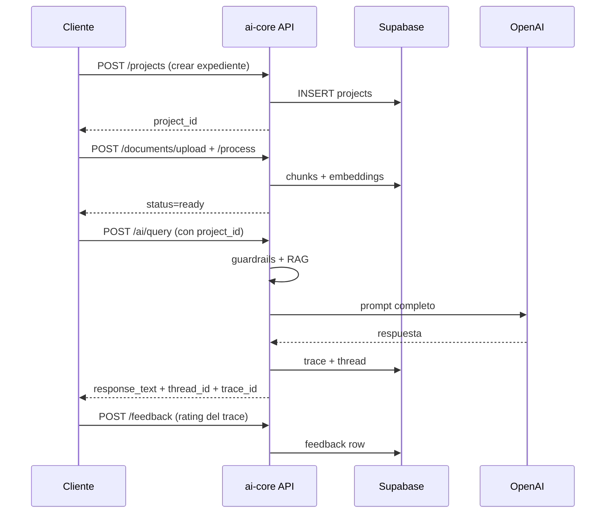

# Documentación del API — `ai-core`

Esta carpeta documenta todos los endpoints HTTP expuestos por la aplicación.
Para una vista interactiva, levanta el servidor y abre **`http://localhost:8000/docs`**
(Swagger UI generado automáticamente por FastAPI).

---

## Índice de endpoints

| Recurso | Archivo | Endpoints |
|---|---|---|
| **AI** (consultas RAG) | [`ai.md`](ai.md) | `POST /ai/query` |
| **Documentos** | [`documents.md`](documents.md) | `POST /documents/upload`, `POST /documents/{id}/process`, `GET /documents`, `GET /documents/{id}` |
| **Proyectos** (expediente) | [`projects.md`](projects.md) | `GET /projects`, `POST /projects`, `GET /projects/{id}`, `PATCH /projects/{id}` |
| **Threads** (conversaciones) | [`threads.md`](threads.md) | `GET /threads`, `POST /threads`, `GET /threads/{id}`, `GET /threads/{id}/messages` |
| **Riesgo** | [`risk.md`](risk.md) | `POST /risk/{project_id}/intake`, `POST /risk/{project_id}/analyze` |
| **Políticas y controles** | [`policies.md`](policies.md) | `POST /policies/generate`, `POST /policies/{project_id}/generate`, `POST /policies/{project_id}/controls` |
| **Prompts** | [`prompts.md`](prompts.md) | `GET /prompts`, `POST /prompts` |
| **Feedback** | [`feedback.md`](feedback.md) | `POST /feedback` |
| **Evaluaciones** | [`evals.md`](evals.md) | `GET /evals/{trace_id}` |
| **Salud** | [`health.md`](health.md) | `GET /health` |

---

## Convenciones generales

### URL base

Por defecto el servicio escucha en:

```
http://localhost:8000
```

En producción reemplaza por tu dominio (ej. `https://api.tuempresa.com`).

### Autenticación

Todas las rutas (excepto `/health`) requieren un header de autorización:

```
Authorization: Bearer <token>
```

> **Estado actual del MVP:** la verificación del token está *stubbed* en
> `app/core/security.py`. Cualquier valor (incluso `Bearer dev-token`) devuelve
> la identidad de desarrollo `tenant_id="dev-tenant"`, `user_id="dev-user"`.
> Antes de producción, sustituir por validación real de JWT de Supabase.

### Tipos de contenido

- **Request bodies JSON:** `Content-Type: application/json`
- **Upload de archivos:** `multipart/form-data` (solo `POST /documents/upload`)

### Códigos de error

Todos los errores devuelven JSON con esta forma:

```json
{
  "error": "<error_code>",
  "detail": "<mensaje legible>"
}
```

| HTTP | `error` | Cuándo |
|---|---|---|
| 400 | `validation_error` | Body inválido (formato, tipos, longitud) |
| 401 | `authentication_error` | Token faltante o inválido |
| 403 | `tenant_isolation_error` | El recurso pertenece a otro tenant |
| 404 | `not_found` | El recurso no existe |
| 422 | `validation_error` | Detección de prompt injection u otra validación de Pydantic |
| 502 | `upstream_error` | Falla del proveedor LLM o de la base vectorial |
| 500 | `internal_server_error` | Excepción no manejada |

### Identidad y multi-tenancy

Todo recurso (documento, proyecto, thread, trace) está asociado a un
`tenant_id`. El servidor lo extrae del token del usuario y aplica un filtro
`WHERE tenant_id = ?` en cada query. Un tenant **nunca** ve recursos de otro
tenant. La excepción son los documentos cuyo `tenant_id="global"` (biblioteca
normativa compartida).

---

## Flujo de uso típico



Para una integración paso a paso (backend, frontend, chatbot) ver
[`integration_guide.md`](integration_guide.md).
