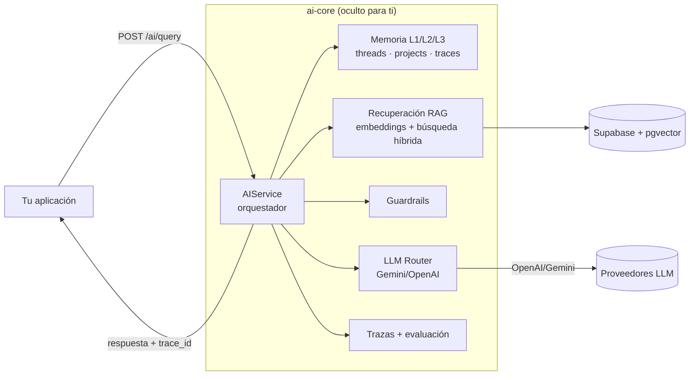

# Guía de Integración con `ai-core`

Esta guía explica **cómo conectar otra aplicación al API**.

> **TL;DR — solo te importa el orquestador.** Para integrar el RAG, tu app
> llama a **un solo endpoint: `POST /ai/query`**. Ese endpoint es la fachada
> HTTP del **orquestador `AIService`**, que por dentro corre todo el pipeline
> (memoria → recuperación → guardrails → LLM → trazas → evaluación). **No
> necesitás** llamar a embeddings, búsqueda de chunks, prompts ni al LLM por
> separado. Ver [El orquestador](#el-orquestador-tu-único-punto-de-integración).

Contenido:

- [El orquestador — tu único punto de integración](#el-orquestador-tu-único-punto-de-integración)
- [Qué endpoint usar según tu caso](#qué-endpoint-usar-según-tu-caso)
- [Autenticación](#autenticación)
- [1. Integración desde un backend](#1-integración-desde-un-backend)
- [2. Integración desde un frontend SPA](#2-integración-desde-un-frontend-spa)
- [3. Integración desde un chatbot](#3-integración-desde-un-chatbot)
- [4. Patrones avanzados](#4-patrones-avanzados)

---

## El orquestador — tu único punto de integración

Todo el RAG está detrás de **un orquestador central**: la clase `AIService`
(`app/domain/ai_service.py`), expuesta por HTTP como **`POST /ai/query`**.



**Qué hace el orquestador por vos (en una sola llamada):**

1. Resuelve o crea el thread de conversación (memoria L1).
2. Carga el expediente del proyecto si mandás `project_id` (memoria L2).
3. Carga el system prompt del `use_case`.
4. Recupera los chunks relevantes (RAG, con filtros por país/framework).
5. Detecta preguntas de justificación ("¿por qué…?") y carga trazas previas (L3).
6. Aplica guardrails (anti prompt-injection).
7. Ensambla el prompt final (system + memoria + contexto + pregunta).
8. Llama al LLM (bloqueante o streaming).
9. Persiste la traza + los mensajes del thread.
10. Corre la evaluación automática.
11. Te devuelve la respuesta + `thread_id` + `trace_id`.

**Lo que NO tenés que hacer (el orquestador ya lo maneja):**

- ❌ Generar embeddings.
- ❌ Consultar `document_chunks` ni las funciones `match_chunks*`.
- ❌ Elegir/ensamblar prompts desde la tabla `prompts`.
- ❌ Llamar a OpenAI/Gemini directamente.
- ❌ Escribir trazas o evaluaciones a mano.

> No existe un endpoint público para "solo recuperar chunks" o "solo llamar al
> LLM": el diseño es deliberadamente **una única puerta de entrada** para que
> la calidad (grounding, guardrails, auditoría) sea consistente para todos los
> integradores.

---

## Qué endpoint usar según tu caso

En el 90% de las integraciones **solo usás `POST /ai/query`**. Los demás
endpoints son para ingesta de documentos (pipeline offline) o para los flujos
estructurados de gobernanza (que a su vez usan el mismo orquestador por dentro).

| Tu objetivo | Endpoint | Notas |
|---|---|---|
| **Q&A / chatbot con RAG** | **`POST /ai/query`** | El caso principal. `use_case: "chatbot"`. |
| **Resumen ejecutivo** | `POST /ai/query` | `use_case: "executive_summary"`. |
| **Ingerir documentos a la base** | `POST /documents/upload` + `POST /documents/{id}/process` | Pipeline **offline**, separado del query. Normalmente lo hace un admin, no cada integrador. |
| **Análisis de riesgo (workflow)** | `POST /risk/{project_id}/analyze` | Orquestador de alto nivel sobre `AIService`; valida y persiste al expediente. |
| **Política + controles (workflow)** | `POST /policies/{project_id}/generate` · `POST /policies/{project_id}/controls` | Igual: workflow estructurado sobre el orquestador. |
| **Recuperar historial de un chat** | `GET /threads/{id}/messages` | Para rehidratar la UI. |
| **Feedback / auditoría** | `POST /feedback` · `GET /evals/{trace_id}` | Usan el `trace_id` que devuelve `/ai/query`. |

> Regla práctica: **si tu integración es "hacer preguntas con RAG", empezá y
> terminá en `POST /ai/query`.**

---

## Autenticación

Cada request lleva un header `Authorization: Bearer <token>`. Hay **dos caminos**
soportados por el orquestador (ver `app/api/deps.py`):

### Path A — Service key + headers de confianza (recomendado para integradores)

Tu backend (o un Edge Function) valida al usuario final y luego llama a
`ai-core` con la **service key** y los headers de tenant/usuario:

```
Authorization: Bearer <AI_CORE_SERVICE_KEY>
X-Tenant-Id:   <id de la institución / tenant>
X-User-Id:     <id del usuario final>
```

`ai-core` confía en los headers `X-*` **solo si** la service key coincide. Este
es el patrón que usa la propia app GovAI (sus Supabase Edge Functions actúan de
proxy). Es la forma recomendada porque mantiene la `service_key` fuera del
navegador y te deja poner tu propia capa de auth/rate-limit.

### Path B — JWT de Supabase directo

Un caller de confianza (scripts de ops, backend propio) manda un JWT de
Supabase; el `tenant_id` se lee de `app_metadata.tenant_id`.

```
Authorization: Bearer <supabase-jwt>
```

La implementación actual valida ambos caminos. `Bearer dev-token` no funciona:
para desarrollo local usá **Path A** con el valor real de
`AI_CORE_SERVICE_KEY` y enviá también `X-Tenant-Id`/`X-User-Id`.

**Otras reglas básicas:**

- `ai-core` **no** se llama desde el navegador del usuario final en producción:
  lo natural es que tu **backend** lo llame y tu frontend hable con **tu**
  backend.
- En desarrollo el CORS está abierto (`allow_origins=["*"]`). En producción,
  restringilo a tu dominio.

---

## 1. Integración desde un backend

### Stack típico

Tu backend (Node.js, Django, Rails, etc.) llama al **orquestador** (`POST
/ai/query`) por HTTP cuando necesite una respuesta con RAG. Para casos que no
son Q&A, ver la tabla [Qué endpoint usar según tu caso](#qué-endpoint-usar-según-tu-caso):

- Generar una respuesta de chatbot → `POST /ai/query`.
- Subir y procesar un documento → `/documents/*` (pipeline offline).
- Disparar un análisis de riesgo → `POST /risk/{project_id}/analyze`.

### Ejemplo en Node.js (Express + axios)

```javascript
// services/aiCore.js
import axios from "axios";

const aicore = axios.create({
  baseURL: process.env.AICORE_BASE_URL,    // http://aicore:8000 (interno)
  timeout: 60000,
  headers: { Authorization: `Bearer ${process.env.AICORE_TOKEN}` },
});

export async function ask(query, { threadId, projectId, frameworkFilter } = {}) {
  const { data } = await aicore.post("/ai/query", {
    query,
    use_case: "chatbot",
    thread_id: threadId,
    project_id: projectId,
    framework_filter: frameworkFilter,
    response_mode: "structured",
  });
  return data;
}
```

```javascript
// routes/chat.js
import { Router } from "express";
import { ask } from "../services/aiCore.js";

const router = Router();

router.post("/chat", async (req, res, next) => {
  try {
    const { message, threadId } = req.body;
    const data = await ask(message, { threadId });
    res.json({
      answer: JSON.parse(data.response_text).answer,
      threadId: data.thread_id,
      traceId: data.trace_id,
    });
  } catch (e) { next(e); }
});

export default router;
```

### Ejemplo en Python (FastAPI + httpx)

```python
import httpx
from fastapi import APIRouter

router = APIRouter()
client = httpx.AsyncClient(
    base_url="http://aicore:8000",
    timeout=60,
    headers={"Authorization": "Bearer YOUR_TOKEN"},
)

@router.post("/chat")
async def chat(payload: dict):
    r = await client.post("/ai/query", json={
        "query": payload["message"],
        "use_case": "chatbot",
        "thread_id": payload.get("thread_id"),
    })
    r.raise_for_status()
    return r.json()
```

### Subida de documentos vía proxy

Si el cliente original es un browser, conviene hacer el upload via tu
backend para no exponer el token de `ai-core`:

```python
@router.post("/documents/upload")
async def upload(file: UploadFile = File(...), country: str | None = Form(None)):
    files = {"file": (file.filename, await file.read(), file.content_type)}
    data = {"country": country} if country else {}
    r = await client.post("/documents/upload", files=files, data=data)
    return r.json()
```

---

## 2. Integración desde un frontend SPA

### Recomendación

**No llames `ai-core` directamente desde el navegador en producción.** Pasa
todo por tu backend para no exponer la `service_key` ni el token.

Para **prototipado / desarrollo local**, puedes llamar directo desde React/Vue
porque el CORS está abierto. Usá el JWT del usuario autenticado de Supabase;
**nunca** expongas `AI_CORE_SERVICE_KEY` en el navegador.

### Hook de React minimal

```tsx
// hooks/useChat.ts
import { useCallback, useState } from "react";

const API = "http://localhost:8000";
const ACCESS_TOKEN = "<supabase-user-jwt>";

export function useChat() {
  const [threadId, setThreadId] = useState<string | null>(null);
  const [messages, setMessages] = useState<{ role: "user" | "assistant"; content: string }[]>([]);
  const [loading, setLoading] = useState(false);

  const ask = useCallback(async (query: string) => {
    setMessages((m) => [...m, { role: "user", content: query }]);
    setLoading(true);
    try {
      const r = await fetch(`${API}/ai/query`, {
        method: "POST",
        headers: {
          "Content-Type": "application/json",
          Authorization: `Bearer ${ACCESS_TOKEN}`,
        },
        body: JSON.stringify({ query, use_case: "chatbot", thread_id: threadId }),
      }).then((r) => r.json());

      setThreadId(r.thread_id);
      setMessages((m) => [...m, { role: "assistant", content: r.response_text }]);
      return r;
    } finally {
      setLoading(false);
    }
  }, [threadId]);

  return { threadId, messages, loading, ask };
}
```

### Restaurar conversación al recargar

```tsx
useEffect(() => {
  const saved = localStorage.getItem("threadId");
  if (saved) {
    fetch(`${API}/threads/${saved}/messages`, {
      headers: { Authorization: `Bearer ${ACCESS_TOKEN}` },
    })
      .then((r) => r.json())
      .then((data) => {
        setThreadId(saved);
        setMessages(data.messages.map((m) => ({ role: m.role, content: m.content })));
      });
  }
}, []);

useEffect(() => {
  if (threadId) localStorage.setItem("threadId", threadId);
}, [threadId]);
```

### Mostrar las citas (modo `structured`)

```tsx
function AssistantBubble({ content }: { content: string }) {
  const parsed = JSON.parse(content);  // structured mode
  return (
    <div>
      <p>{parsed.answer}</p>
      <ul>
        {parsed.citations.map((c) => (
          <li key={c.chunk_id}>
            <strong>{c.document_name}</strong> §{c.section}: <em>{c.quote}</em>
          </li>
        ))}
      </ul>
      <small>Confianza: {parsed.confidence}</small>
    </div>
  );
}
```

---

## 3. Integración desde un chatbot

Casos típicos: WhatsApp Business API, Slack bot, Microsoft Teams bot,
Telegram bot. La clave es **mantener `thread_id` por usuario**.

### Patrón general (pseudocódigo)

```python
# Asume un mapeo persistente userId -> threadId
THREADS = {}  # en producción: Redis o DB

async def on_message(user_id: str, text: str) -> str:
    thread_id = THREADS.get(user_id)
    r = await aicore_post("/ai/query", {
        "query": text,
        "use_case": "chatbot",
        "thread_id": thread_id,
    })
    THREADS[user_id] = r["thread_id"]
    return r["response_text"]
```

### Ejemplo Slack Bolt (Python)

```python
from slack_bolt.async_app import AsyncApp
import httpx, redis

app = AsyncApp(token=SLACK_BOT_TOKEN)
r = redis.from_url(REDIS_URL)
ai = httpx.AsyncClient(base_url=AICORE_URL, headers={"Authorization": f"Bearer {AICORE_TOKEN}"})

@app.message()
async def chat(message, say):
    user = message["user"]
    thread_id = r.get(f"slack:thread:{user}")
    resp = await ai.post("/ai/query", json={
        "query": message["text"],
        "use_case": "chatbot",
        "thread_id": thread_id.decode() if thread_id else None,
    })
    data = resp.json()
    r.set(f"slack:thread:{user}", data["thread_id"])
    await say(data["response_text"])
```

### Tip — Slash commands para flujos largos

Para `/risk analyze`, no respondas en la misma request: úsalo como
fire-and-forget (responder "Analizando…", correr en background, postear en el
canal cuando termine). Slack tiene timeout de 3 s; `ai-core` puede tardar 20 s.

---

## 4. Patrones avanzados

### A. Manejo de errores y retries

`ai-core` puede devolver `502 upstream_error` si OpenAI tiene rate-limit.
Implementa **backoff exponencial**:

```python
import time, random

def ai_query_with_retry(payload, attempts=3):
    for i in range(attempts):
        try:
            r = httpx.post(f"{API}/ai/query", json=payload, timeout=60)
            r.raise_for_status()
            return r.json()
        except httpx.HTTPStatusError as e:
            if e.response.status_code in (429, 502, 503) and i < attempts - 1:
                time.sleep((2 ** i) + random.random())
                continue
            raise
```

### B. Streaming (SSE)

El orquestador **sí expone streaming**: mandá `"stream": true` en el body de
`POST /ai/query` y la respuesta llega como Server-Sent Events (`text/event-stream`),
token a token, cerrando con un evento `done` que trae `trace_id` y metadatos.

```bash
curl -N -X POST "$AICORE_URL/ai/query" \
  -H "Authorization: Bearer $AICORE_TOKEN" \
  -H 'Content-Type: application/json' \
  -d '{"query":"¿Qué exige ISO 42001 sobre riesgos?","use_case":"chatbot","stream":true}'
```

> `stream: true` es **incompatible con `response_mode: "structured"`** (devuelve
> 422). Detalle de los eventos SSE y ejemplo en JavaScript en
> [`ai.md`](ai.md#streaming-sse).

Si preferís no manejar SSE, dejá `stream: false` (default) y para la UX usá
**optimistic updates**: insertá el mensaje del usuario, mostrá un placeholder
"El asistente está pensando…" y reemplazalo cuando llega la respuesta.

### C. Cacheo del lado de tu backend

Para queries idénticas frecuentes, cachéa por `(query, framework_filter,
country)` en Redis con TTL corto (ej. 5 min). **No cachees** si la query
incluye `project_id` (la respuesta depende del estado del expediente).

### D. Telemetría cruzada

Cada respuesta de `ai-core` trae `trace_id`. Inclúyelo en tus logs:

```python
logger.info("chat reply", extra={"trace_id": data["trace_id"], "user_id": user_id})
```

Así puedes correlacionar problemas en tu app con la trace exacta y revisarla
con `GET /evals/{trace_id}` o desde el dashboard de Supabase.

### E. Selección de modelo por uso

Hoy el modelo se configura globalmente con `LLM_DEFAULT_MODEL`. Si necesitas
distintos modelos por tipo de consulta, dos opciones:

1. **Multi-instancia**: corre varias instancias de `ai-core` con distintas
   configuraciones (`LLM_DEFAULT_MODEL=gpt-4o` para análisis, `gpt-4o-mini`
   para chatbot) y enruta desde tu backend.
2. **Patch del router**: extender `app/domain/llm/router.py` para leer el
   modelo desde el request (campo `model` opcional). Cambio chico, ver TODO
   en ese archivo.

---

## Checklist de integración

- [ ] Identificas tu backend como cliente único de `ai-core` (no el browser).
- [ ] Guardas `thread_id` por usuario para mantener conversaciones.
- [ ] Manejas timeouts altos (≥ 60 s) en endpoints largos (`/risk`, `/policies`).
- [ ] Implementas retry con backoff para errores 5xx.
- [ ] Loggeas `trace_id` en cada interacción para auditoría.
- [ ] Restringes `CORS` y rotación de tokens antes de producción.
- [ ] Si recolectas feedback, lo envías a `POST /feedback` con la `trace_id`.

---

## Ver también

- [Catálogo de endpoints](README.md)
- [Arquitectura RAG](../rag/full_pipeline.md)
- [Decisiones de diseño](../decisions/design_choices.md)
