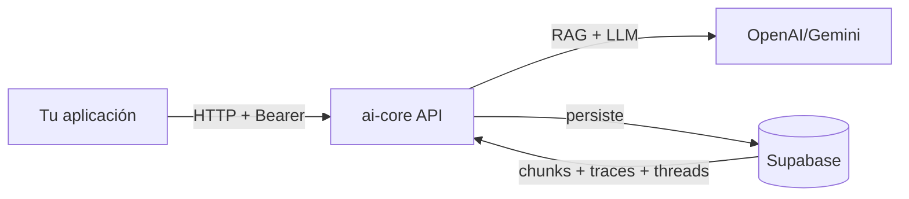

# Guía de Integración con `ai-core`

Esta guía explica **cómo conectar otra aplicación al API**. Cubre tres
escenarios típicos:

1. [Integración desde un backend](#1-integración-desde-un-backend)
2. [Integración desde un frontend SPA](#2-integración-desde-un-frontend-spa)
3. [Integración desde un chatbot](#3-integración-desde-un-chatbot)

Más una sección final con [patrones avanzados](#4-patrones-avanzados): manejo
de threads, streaming-like UX, retries, cacheo.

---

## Modelo mental rápido



Reglas básicas:

- `ai-core` **no** se llama desde el navegador del usuario final directamente
  en producción: lo natural es que tu **backend** lo llame y tu frontend hable
  con **tu** backend. Esto te permite añadir tu propia capa de auth,
  rate-limit y tracking.
- En desarrollo, el CORS está abierto (`allow_origins=["*"]`). En producción,
  cambiarlo a tu dominio.
- Cada request debe llevar `Authorization: Bearer <token>`. Hoy cualquier
  valor es aceptado (auth stubbed); mañana será un JWT de Supabase.

---

## 1. Integración desde un backend

### Stack típico

Tu backend (Node.js, Django, Rails, etc.) llama a `ai-core` por HTTP cuando
necesite:

- Generar una respuesta de chatbot.
- Subir y procesar un documento.
- Disparar un análisis de riesgo.

### Ejemplo en Node.js (Express + axios)

```javascript
// services/aiCore.js
import axios from "axios";

const aicore = axios.create({
  baseURL: process.env.AICORE_BASE_URL,    // http://aicore:8000 (interno)
  timeout: 60000,
  headers: { Authorization: `Bearer ${process.env.AICORE_TOKEN}` },
});

export async function ask(query, { threadId, projectId, frameworkFilter } = {}) {
  const { data } = await aicore.post("/ai/query", {
    query,
    use_case: "chatbot",
    thread_id: threadId,
    project_id: projectId,
    framework_filter: frameworkFilter,
    response_mode: "structured",
  });
  return data;
}
```

```javascript
// routes/chat.js
import { Router } from "express";
import { ask } from "../services/aiCore.js";

const router = Router();

router.post("/chat", async (req, res, next) => {
  try {
    const { message, threadId } = req.body;
    const data = await ask(message, { threadId });
    res.json({
      answer: JSON.parse(data.response_text).answer,
      threadId: data.thread_id,
      traceId: data.trace_id,
    });
  } catch (e) { next(e); }
});

export default router;
```

### Ejemplo en Python (FastAPI + httpx)

```python
import httpx
from fastapi import APIRouter

router = APIRouter()
client = httpx.AsyncClient(
    base_url="http://aicore:8000",
    timeout=60,
    headers={"Authorization": "Bearer YOUR_TOKEN"},
)

@router.post("/chat")
async def chat(payload: dict):
    r = await client.post("/ai/query", json={
        "query": payload["message"],
        "use_case": "chatbot",
        "thread_id": payload.get("thread_id"),
    })
    r.raise_for_status()
    return r.json()
```

### Subida de documentos vía proxy

Si el cliente original es un browser, conviene hacer el upload via tu
backend para no exponer el token de `ai-core`:

```python
@router.post("/documents/upload")
async def upload(file: UploadFile = File(...), country: str | None = Form(None)):
    files = {"file": (file.filename, await file.read(), file.content_type)}
    data = {"country": country} if country else {}
    r = await client.post("/documents/upload", files=files, data=data)
    return r.json()
```

---

## 2. Integración desde un frontend SPA

### Recomendación

**No llames `ai-core` directamente desde el navegador en producción.** Pasa
todo por tu backend para no exponer la `service_key` ni el token.

Para **prototipado / desarrollo local**, puedes llamar directo desde React/Vue
porque el CORS está abierto.

### Hook de React minimal

```tsx
// hooks/useChat.ts
import { useCallback, useState } from "react";

const API = "http://localhost:8000";

export function useChat() {
  const [threadId, setThreadId] = useState<string | null>(null);
  const [messages, setMessages] = useState<{ role: "user" | "assistant"; content: string }[]>([]);
  const [loading, setLoading] = useState(false);

  const ask = useCallback(async (query: string) => {
    setMessages((m) => [...m, { role: "user", content: query }]);
    setLoading(true);
    try {
      const r = await fetch(`${API}/ai/query`, {
        method: "POST",
        headers: { "Content-Type": "application/json", Authorization: "Bearer dev-token" },
        body: JSON.stringify({ query, use_case: "chatbot", thread_id: threadId }),
      }).then((r) => r.json());

      setThreadId(r.thread_id);
      setMessages((m) => [...m, { role: "assistant", content: r.response_text }]);
      return r;
    } finally {
      setLoading(false);
    }
  }, [threadId]);

  return { threadId, messages, loading, ask };
}
```

### Restaurar conversación al recargar

```tsx
useEffect(() => {
  const saved = localStorage.getItem("threadId");
  if (saved) {
    fetch(`${API}/threads/${saved}/messages`, {
      headers: { Authorization: "Bearer dev-token" },
    })
      .then((r) => r.json())
      .then((data) => {
        setThreadId(saved);
        setMessages(data.messages.map((m) => ({ role: m.role, content: m.content })));
      });
  }
}, []);

useEffect(() => {
  if (threadId) localStorage.setItem("threadId", threadId);
}, [threadId]);
```

### Mostrar las citas (modo `structured`)

```tsx
function AssistantBubble({ content }: { content: string }) {
  const parsed = JSON.parse(content);  // structured mode
  return (
    <div>
      <p>{parsed.answer}</p>
      <ul>
        {parsed.citations.map((c) => (
          <li key={c.chunk_id}>
            <strong>{c.document_name}</strong> §{c.section}: <em>{c.quote}</em>
          </li>
        ))}
      </ul>
      <small>Confianza: {parsed.confidence}</small>
    </div>
  );
}
```

---

## 3. Integración desde un chatbot

Casos típicos: WhatsApp Business API, Slack bot, Microsoft Teams bot,
Telegram bot. La clave es **mantener `thread_id` por usuario**.

### Patrón general (pseudocódigo)

```python
# Asume un mapeo persistente userId -> threadId
THREADS = {}  # en producción: Redis o DB

async def on_message(user_id: str, text: str) -> str:
    thread_id = THREADS.get(user_id)
    r = await aicore_post("/ai/query", {
        "query": text,
        "use_case": "chatbot",
        "thread_id": thread_id,
    })
    THREADS[user_id] = r["thread_id"]
    return r["response_text"]
```

### Ejemplo Slack Bolt (Python)

```python
from slack_bolt.async_app import AsyncApp
import httpx, redis

app = AsyncApp(token=SLACK_BOT_TOKEN)
r = redis.from_url(REDIS_URL)
ai = httpx.AsyncClient(base_url=AICORE_URL, headers={"Authorization": f"Bearer {AICORE_TOKEN}"})

@app.message()
async def chat(message, say):
    user = message["user"]
    thread_id = r.get(f"slack:thread:{user}")
    resp = await ai.post("/ai/query", json={
        "query": message["text"],
        "use_case": "chatbot",
        "thread_id": thread_id.decode() if thread_id else None,
    })
    data = resp.json()
    r.set(f"slack:thread:{user}", data["thread_id"])
    await say(data["response_text"])
```

### Tip — Slash commands para flujos largos

Para `/risk analyze`, no respondas en la misma request: úsalo como
fire-and-forget (responder "Analizando…", correr en background, postear en el
canal cuando termine). Slack tiene timeout de 3 s; `ai-core` puede tardar 20 s.

---

## 4. Patrones avanzados

### A. Manejo de errores y retries

`ai-core` puede devolver `502 upstream_error` si OpenAI tiene rate-limit.
Implementa **backoff exponencial**:

```python
import time, random

def ai_query_with_retry(payload, attempts=3):
    for i in range(attempts):
        try:
            r = httpx.post(f"{API}/ai/query", json=payload, timeout=60)
            r.raise_for_status()
            return r.json()
        except httpx.HTTPStatusError as e:
            if e.response.status_code in (429, 502, 503) and i < attempts - 1:
                time.sleep((2 ** i) + random.random())
                continue
            raise
```

### B. Streaming-like UX (sin streaming real)

`ai-core` no expone streaming SSE en el MVP. Para UX percibida, usa
**optimistic updates**:

1. Inserta el mensaje del usuario inmediatamente.
2. Muestra un placeholder "El asistente está pensando…" con typing dots.
3. Cuando llega la respuesta, reemplaza el placeholder.

### C. Cacheo del lado de tu backend

Para queries idénticas frecuentes, cachéa por `(query, framework_filter,
country)` en Redis con TTL corto (ej. 5 min). **No cachees** si la query
incluye `project_id` (la respuesta depende del estado del expediente).

### D. Telemetría cruzada

Cada respuesta de `ai-core` trae `trace_id`. Inclúyelo en tus logs:

```python
logger.info("chat reply", extra={"trace_id": data["trace_id"], "user_id": user_id})
```

Así puedes correlacionar problemas en tu app con la trace exacta y revisarla
con `GET /evals/{trace_id}` o desde el dashboard de Supabase.

### E. Selección de modelo por uso

Hoy el modelo se configura globalmente con `LLM_DEFAULT_MODEL`. Si necesitas
distintos modelos por tipo de consulta, dos opciones:

1. **Multi-instancia**: corre varias instancias de `ai-core` con distintas
   configuraciones (`LLM_DEFAULT_MODEL=gpt-4o` para análisis, `gpt-4o-mini`
   para chatbot) y enruta desde tu backend.
2. **Patch del router**: extender `app/domain/llm/router.py` para leer el
   modelo desde el request (campo `model` opcional). Cambio chico, ver TODO
   en ese archivo.

---

## Checklist de integración

- [ ] Identificas tu backend como cliente único de `ai-core` (no el browser).
- [ ] Guardas `thread_id` por usuario para mantener conversaciones.
- [ ] Manejas timeouts altos (≥ 60 s) en endpoints largos (`/risk`, `/policies`).
- [ ] Implementas retry con backoff para errores 5xx.
- [ ] Loggeas `trace_id` en cada interacción para auditoría.
- [ ] Restringes `CORS` y rotación de tokens antes de producción.
- [ ] Si recolectas feedback, lo envías a `POST /feedback` con la `trace_id`.

---

## Ver también

- [Catálogo de endpoints](README.md)
- [Arquitectura RAG](../rag/full_pipeline.md)
- [Decisiones de diseño](../decisions/design_choices.md)
