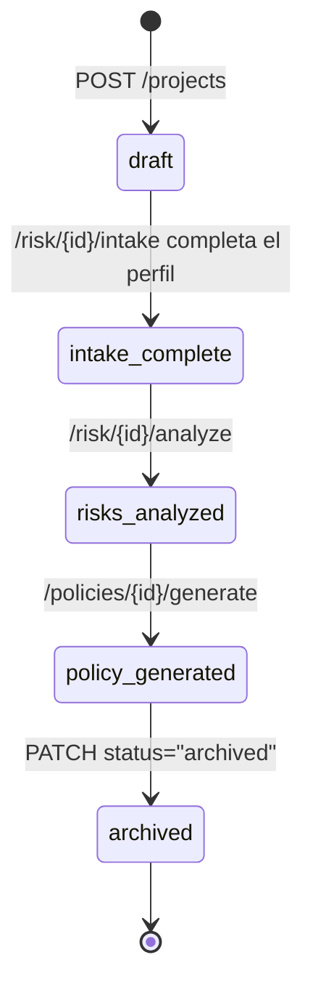

# Endpoints de Proyectos

Un **proyecto** es el "expediente" central al que se atan riesgos, políticas,
controles, threads de chat y traces. Funciona como **memoria L2**: cuando se
pasa `project_id` a `/ai/query`, el orquestador inyecta un resumen del
expediente en el prompt para que el LLM responda con conocimiento del proyecto.

---

## Modelo de datos

```jsonc
{
  "id": "uuid",
  "tenant_id": "dev-tenant",
  "name": "Asistente de cobranza interno",
  "description": "...",
  "project_profile": {
    "project_name": "...",
    "project_description": "...",
    "ai_type": "llm",                     // llm | computer_vision | classification | recommendation | generative_other | other
    "data_used": ["pii"],                  // pii | phi | pci | ip_confidential | public
    "industry": "financial_services",
    "affected_audience": "...",
    "autonomy_level": "human_in_loop",    // advisor | human_in_loop | autonomous
    "deployment": "internal",             // internal | external_clients | public_open
    "country": "costa-rica",
    "existing_vendor": "OpenAI",
    "notes": "Notas libres del usuario"
  },
  "risk_register": { /* generado por POST /risk/{id}/analyze */ },
  "policy":        { /* generado por POST /policies/{id}/generate */ },
  "controls":      { /* generado por POST /policies/{id}/controls */ },
  "status": "draft",                      // draft | intake_complete | risks_analyzed | policy_generated | archived
  "created_at": "2026-04-25T15:00:00Z",
  "updated_at": "2026-04-25T15:00:00Z"
}
```

---

## `GET /projects`

Lista los proyectos del tenant.

```bash
curl "http://localhost:8000/projects?limit=50&offset=0" \
  -H "Authorization: Bearer YOUR_TOKEN"
```

### Response

```json
{
  "projects": [ { /* Project, ver arriba */ } ],
  "total": 12
}
```

---

## `POST /projects`

Crea un proyecto nuevo. El `project_profile` puede llegar parcial — se
completa después con `PATCH` o con la entrevista `/risk/{id}/intake`.

```bash
curl -X POST http://localhost:8000/projects \
  -H "Authorization: Bearer YOUR_TOKEN" \
  -H "Content-Type: application/json" \
  -d '{
    "name": "Chatbot de soporte cliente",
    "description": "Asistente conversacional para respuestas de primer nivel",
    "project_profile": {
      "ai_type": "llm",
      "data_used": ["pii"],
      "industry": "telecom",
      "deployment": "external_clients"
    }
  }'
```

### Errores

| HTTP | Causa |
|---|---|
| 422 | `name` vacío o > 200 caracteres. |

---

## `GET /projects/{project_id}`

Devuelve el expediente completo. Solo accesible si pertenece al tenant del
usuario.

```bash
curl http://localhost:8000/projects/3f8a-... \
  -H "Authorization: Bearer YOUR_TOKEN"
```

### Errores

| HTTP | Causa |
|---|---|
| 404 | Proyecto no encontrado. |
| 403 | Proyecto de otro tenant. |

---

## `PATCH /projects/{project_id}`

Actualización parcial. Cualquier campo puede omitirse y se conserva su valor
actual.

```bash
curl -X PATCH http://localhost:8000/projects/3f8a-... \
  -H "Authorization: Bearer YOUR_TOKEN" \
  -H "Content-Type: application/json" \
  -d '{
    "status": "intake_complete",
    "project_profile": {
      "affected_audience": "clientes residenciales mayores de 18 años",
      "autonomy_level": "advisor"
    }
  }'
```

> Los campos `risk_register`, `policy` y `controls` normalmente los escriben
> los orquestadores (`/risk/...`, `/policies/...`), pero también puedes
> sobreescribirlos directamente con `PATCH` si tienes una versión externa.

---

## Ciclo de vida típico



---

## Integración con `/ai/query`

Cualquier llamada a `/ai/query` con `project_id` activa la **memoria L2**:

```python
import requests

resp = requests.post(
    "http://localhost:8000/ai/query",
    headers={"Authorization": "Bearer YOUR_TOKEN"},
    json={
        "query": "¿Por qué clasificaste este proyecto como alto riesgo?",
        "use_case": "chatbot",
        "project_id": "3f8a-...",
    },
).json()

print(resp["used_reasoning_memory"])  # True si detectó "por qué" + cargó traces
```

El sistema:

1. Carga el proyecto y formatea un bloque "Contexto del proyecto" (perfil +
   riesgos + tier EU AI Act).
2. Detecta el patrón "¿por qué…?" y carga las últimas 5 traces de tipo
   `risk_analysis`, `risk_intake`, `controls_generation`, `policy_generation`.
3. Inyecta ambos al prompt antes de los chunks RAG.

Ver el ensamblaje detallado en
[`../rag/full_pipeline.md`](../rag/full_pipeline.md#7-ensamblaje-del-prompt).
