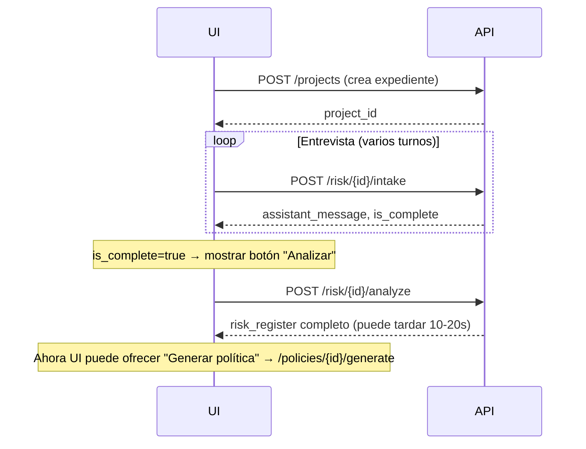

# Endpoints de Riesgo

Dos endpoints, un endpoint por paso del workflow:

| Endpoint | Paso | Use case | Output |
|---|---|---|---|
| `POST /risk/{project_id}/intake` | B2 — Entrevista conversacional | `risk_intake` | Mensaje del asistente + `is_complete` |
| `POST /risk/{project_id}/analyze` | B3 — Orquestador de riesgos | `risk_analysis` (multi-step) | Registro de riesgos estructurado |

Ambos viven bajo `/risk` (no `/projects/{id}/risk`) para mantener URLs cortas
y un grupo OpenAPI limpio. Internamente leen y escriben al expediente del
proyecto vía `ProjectService`.

---

## `POST /risk/{project_id}/intake`

Avanza un turno de la entrevista guiada que llena `project_profile`. El LLM
hace preguntas en orden lógico (tipo de IA → datos → audiencia → autonomía →
despliegue) y el usuario responde. Cuando el modelo decide que el perfil está
completo, devuelve `is_complete=true` y el frontend puede pasar a `/analyze`.

### Request

```
POST /risk/{project_id}/intake
Content-Type: application/json
Authorization: Bearer <token>
```

```jsonc
{
  "message": "Es un asistente de cobranza interna que clasifica casos.",
  "thread_id": "uuid|null"  // null en el primer turno; el server crea el thread
}
```

### Response

```jsonc
{
  "project_id": "uuid",
  "thread_id": "uuid",       // siempre presente, reusable en el siguiente turno
  "assistant_message": "Perfecto. ¿Qué tipo de datos procesa el sistema?...",
  "is_complete": false,       // true cuando el perfil tiene todos los campos críticos
  "trace_id": "uuid|null"
}
```

### Ejemplo

```python
import requests

BASE = "http://localhost:8000"
HEADERS = {"Authorization": "Bearer YOUR_TOKEN"}

project_id = "3f8a-..."
thread_id = None

while True:
    user_msg = input("Tú: ")
    r = requests.post(
        f"{BASE}/risk/{project_id}/intake",
        headers=HEADERS,
        json={"message": user_msg, "thread_id": thread_id},
    ).json()
    thread_id = r["thread_id"]
    print("Bot:", r["assistant_message"])
    if r["is_complete"]:
        print(">>> Perfil completo. Listo para /analyze")
        break
```

### Errores

| HTTP | Causa |
|---|---|
| 404 | `project_id` no existe (o pertenece a otro tenant). |
| 422 | `message` vacío. |
| 502 | Falla del LLM. |

---

## `POST /risk/{project_id}/analyze`

Ejecuta el orquestador de análisis de riesgo. Es una llamada **multi-step
larga** (8–20 segundos): combina recuperación normativa por framework,
construcción de prompt extendido y parseo del JSON de respuesta.

### Lo que hace internamente

1. Lee el `project_profile` del proyecto (o usa `profile_override` si viene).
2. Recupera chunks normativos relevantes con `framework_filter` automático
   según el perfil (ISO 42001, NIST AI RMF, EU AI Act, OWASP, etc.).
3. Llama al LLM con `use_case="risk_analysis"` (system prompt versionado en
   la tabla `prompts`).
4. Parsea la respuesta JSON contra el schema `RiskRegister` (Pydantic).
5. Persiste el resultado en `projects.risk_register` y actualiza
   `status="risks_analyzed"`.
6. Crea una trace de auditoría.

### Request

```jsonc
{
  "profile_override": null,    // opcional: pasar un ProjectProfile temporal sin persistirlo
  "country": "costa-rica"       // opcional: forzar filtro de país en RAG
}
```

### Response

```jsonc
{
  "project_id": "uuid",
  "trace_id": "uuid|null",
  "risk_register": {
    "eu_ai_act_tier": "alto",                    // prohibido | alto | limitado | mínimo
    "tier_rationale": "El sistema realiza scoring crediticio sobre personas físicas...",
    "requires_dpia": true,
    "applicable_frameworks": ["iso_42001", "nist_airmf", "eu_ai_act", "gdpr"],
    "risks": [
      {
        "id": "R-001",
        "category": "bias",
        "source_framework": "nist_airmf",
        "source_reference": "MAP 2.3",
        "description": "Posible sesgo demográfico en datos de entrenamiento...",
        "likelihood": 4,
        "impact": 5,
        "inherent_score": 20,
        "suggested_controls": ["Análisis de equidad por subgrupo", "Auditoría externa anual"],
        "nist_function": "MAP",
        "citations": [
          { "chunk_id": "...", "document_name": "NIST AI RMF 1.0", "section": "MAP 2.3" }
        ]
      }
    ],
    "assumptions": ["Se asume despliegue interno con human-in-the-loop"],
    "executive_summary": "El proyecto se ubica en tier ALTO bajo EU AI Act..."
  }
}
```

### Ejemplo

```bash
curl -X POST http://localhost:8000/risk/3f8a-.../analyze \
  -H "Authorization: Bearer YOUR_TOKEN" \
  -H "Content-Type: application/json" \
  -d '{ "country": "costa-rica" }'
```

### Errores

| HTTP | Causa |
|---|---|
| 404 | Proyecto no existe. |
| 422 | El LLM devolvió JSON inválido tras N reintentos. |
| 502 | Falla del LLM o de Supabase. |

> **Tip:** si la respuesta del LLM no se ajusta al schema, los logs de
> `app/domain/risk/service.py` muestran el JSON crudo recibido. Esa es la mejor
> pista para ajustar el system prompt en `scripts/seed_prompts.py`.

---

## Workflow recomendado en el frontend


