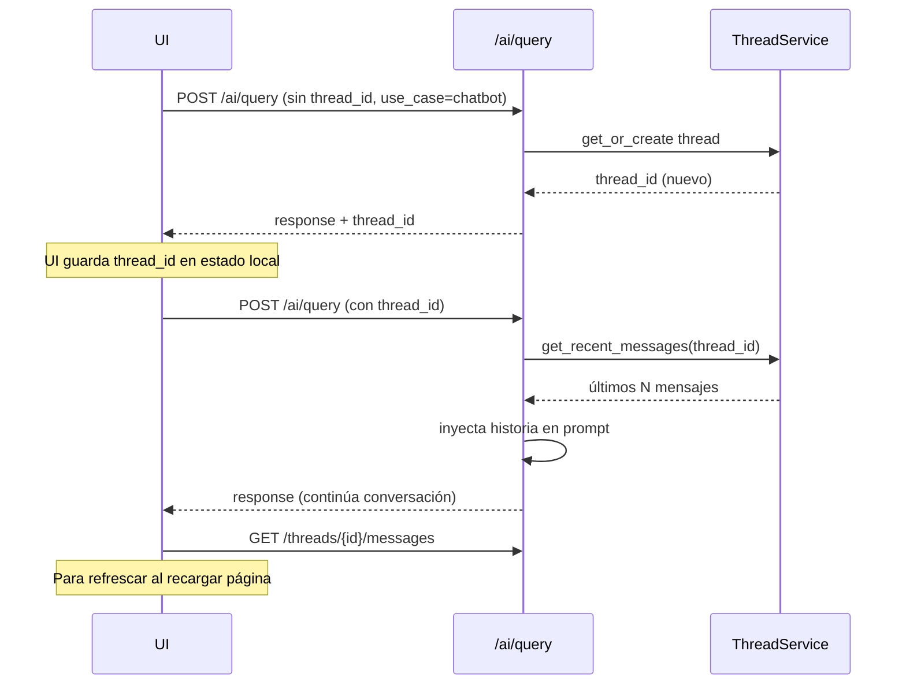

# Endpoints de Threads (Conversaciones)

Un **thread** es una sesión de chat persistente. Es la **memoria L1** del
sistema: cuando una llamada a `/ai/query` incluye un `thread_id`, los últimos
turnos de la conversación se inyectan en el prompt.

> **Importante:** este router **no expone** un endpoint para enviar mensajes.
> Todo turno de chat va por `POST /ai/query`. Aquí solo se listan, leen y se
> crean threads vacíos.

---

## Modelo de datos

### Thread

```jsonc
{
  "id": "uuid",
  "tenant_id": "dev-tenant",
  "user_id": "dev-user",
  "project_id": "uuid|null",
  "use_case": "chatbot",
  "title": "Chatbot - 25/04 10:30",
  "status": "open",                        // open | archived
  "created_at": "2026-04-25T15:30:00Z",
  "updated_at": "2026-04-25T15:31:00Z"
}
```

### Message

```jsonc
{
  "id": "uuid",
  "thread_id": "uuid",
  "role": "user | assistant | system",
  "content": "string",
  "trace_id": "uuid|null",                 // poblado solo en mensajes assistant
  "created_at": "2026-04-25T15:30:05Z"
}
```

---

## `GET /threads`

Lista los threads del usuario actual (para el sidebar de la UI).

### Query params

| Param | Default | Descripción |
|---|---|---|
| `project_id` | null | Filtra a threads ligados a un proyecto. |
| `only_mine` | true | `false` para vista admin (todos los threads del tenant). |
| `limit` | 50 | Máximo a devolver. |

```bash
curl "http://localhost:8000/threads?only_mine=true&limit=20" \
  -H "Authorization: Bearer YOUR_TOKEN"
```

### Response

```json
{
  "threads": [ { /* Thread */ } ],
  "total": 5
}
```

---

## `POST /threads`

Crea un thread vacío. Normalmente **no necesitas llamar este endpoint**: el
servidor crea threads automáticamente cuando el `use_case` es conversacional
y el cliente no pasa `thread_id`.

### Request

```json
{
  "use_case": "chatbot",
  "project_id": "uuid|null",
  "title": "Mi chat sobre ISO 42001"
}
```

```bash
curl -X POST http://localhost:8000/threads \
  -H "Authorization: Bearer YOUR_TOKEN" \
  -H "Content-Type: application/json" \
  -d '{ "use_case": "chatbot", "title": "Análisis ISO 42001" }'
```

---

## `GET /threads/{thread_id}`

Devuelve la metadata de un thread. Verifica que pertenece al tenant del
usuario.

```bash
curl http://localhost:8000/threads/9b81-... \
  -H "Authorization: Bearer YOUR_TOKEN"
```

### Errores

| HTTP | Causa |
|---|---|
| 404 | Thread no existe. |
| 403 | Thread de otro tenant. |

---

## `GET /threads/{thread_id}/messages`

Devuelve los mensajes en orden cronológico. La UI lo usa para "rehidratar"
una conversación al hacer click en el sidebar.

### Query params

| Param | Default | Descripción |
|---|---|---|
| `limit` | 200 | Cantidad máxima (los más recientes, después invertidos a orden cronológico). |

```bash
curl "http://localhost:8000/threads/9b81-.../messages?limit=100" \
  -H "Authorization: Bearer YOUR_TOKEN"
```

### Response

```json
{
  "messages": [
    {
      "id": "...",
      "thread_id": "9b81-...",
      "role": "user",
      "content": "¿Qué es ISO 42001?",
      "trace_id": null,
      "created_at": "2026-04-25T15:30:00Z"
    },
    {
      "id": "...",
      "thread_id": "9b81-...",
      "role": "assistant",
      "content": "ISO/IEC 42001 es...",
      "trace_id": "1d4a-...",
      "created_at": "2026-04-25T15:30:03Z"
    }
  ],
  "total": 2
}
```

---

## Patrón de uso típico


