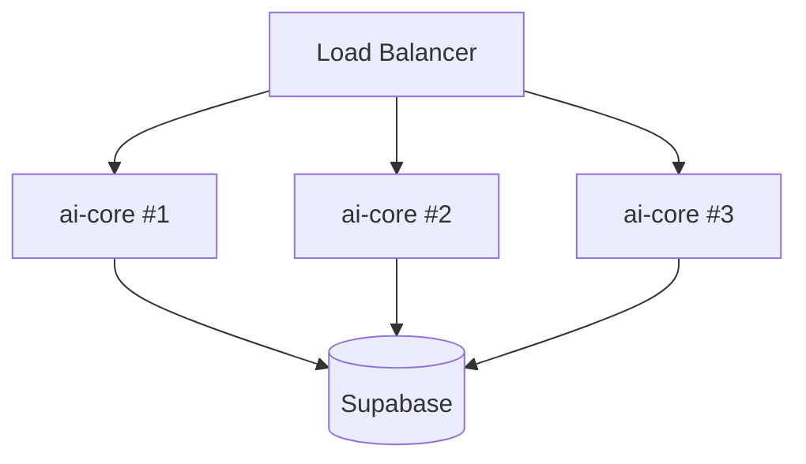

# Docker y Despliegue

Esta guía cubre cómo está configurado Docker, cómo construir y correr la
imagen, cómo manejar variables de entorno, y consideraciones de
escalabilidad.

---

## 1. Dockerfile

**Archivo:** `Dockerfile` en la raíz del repo.

Es un **build multi-stage** con dos stages:

### Stage `builder`

```dockerfile
FROM python:3.11-slim AS builder
WORKDIR /app
COPY requirements.txt .
RUN pip install --no-cache-dir --upgrade pip && \
    pip install --no-cache-dir -r requirements.txt
```

**Por qué:** Docker cachea cada layer. Como `requirements.txt` cambia rara
vez, esta capa se reusa entre builds y la instalación de pip (lenta) solo
ocurre cuando cambia el archivo.

### Stage `runtime`

```dockerfile
FROM python:3.11-slim AS runtime
ENV PYTHONDONTWRITEBYTECODE=1 PYTHONUNBUFFERED=1
WORKDIR /app
COPY --from=builder /usr/local/lib/python3.11/site-packages /usr/local/lib/python3.11/site-packages
COPY --from=builder /usr/local/bin /usr/local/bin
COPY app/ ./app/
RUN mkdir -p /app/uploads
EXPOSE 8000
CMD ["uvicorn", "app.main:app", "--host", "0.0.0.0", "--port", "8000"]
```

**Decisiones clave:**

- **Slim base** (`python:3.11-slim`) → imagen final ~200 MB en vez de ~1 GB.
- **PYTHONUNBUFFERED=1** → los logs aparecen instantáneamente en
  `docker logs` (sin buffering).
- **`--host 0.0.0.0`** → necesario para que el contenedor reciba conexiones
  externas. `127.0.0.1` solo escucha dentro del contenedor.
- **No `--reload`** → producción. Para dev local con auto-reload, correr
  `uvicorn` directamente sin Docker.
- **`uploads/` se crea**, pero en producción **monta un volumen** para que
  los archivos persistan entre reinicios.

---

## 2. Construir la imagen

```bash
docker build -t aicore .
```

Tiempo típico: ~2 min en frío, ~10 s en caliente (cache).

Para forzar rebuild sin caché:

```bash
docker build --no-cache -t aicore .
```

Para tag con versión:

```bash
docker build -t aicore:0.1.0 -t aicore:latest .
```

---

## 3. Correr la imagen

### Opción mínima

```bash
docker run -p 8000:8000 --env-file .env aicore
```

- `-p 8000:8000` → publica el puerto 8000 del contenedor en el host.
- `--env-file .env` → inyecta todas las vars de `.env` como env vars del
  contenedor.

### Opción con persistencia de uploads

```bash
docker run -p 8000:8000 \
  --env-file .env \
  -v $(pwd)/uploads:/app/uploads \
  aicore
```

El bind-mount asegura que los archivos subidos sobrevivan a `docker rm`.

### Opción detached + logs

```bash
docker run -d --name aicore \
  -p 8000:8000 \
  --env-file .env \
  -v $(pwd)/uploads:/app/uploads \
  --restart unless-stopped \
  aicore

docker logs -f aicore
```

---

## 4. docker-compose

**Archivo:** `docker-compose.yml`.

En el repo, compose define **un solo servicio activo: `postgres`** (con
pgvector). El servicio `api` está comentado a propósito; lo normal en
desarrollo es:

- **DB local con pgvector** → `docker compose up -d postgres`
- **API con uvicorn local** → `uvicorn app.main:app --reload`

Esto da el mejor flujo (auto-reload del código + DB persistente).

### Levantar la DB

```bash
docker compose up -d
docker compose logs -f postgres
```

### Conectarse desde un cliente SQL

```bash
psql -h localhost -p 5432 -U postgres -d aicore
# password: postgres (definido en .env / variables default)
```

Aplicar migraciones:

```bash
psql -h localhost -U postgres -d aicore -f app/db/migrations/001_initial.sql
psql -h localhost -U postgres -d aicore -f app/db/migrations/002_add_country.sql
psql -h localhost -U postgres -d aicore -f app/db/migrations/003_fix_ivfflat_probes.sql
psql -h localhost -U postgres -d aicore -f app/db/migrations/004_projects_memory_framework.sql
```

> **Si usas Supabase Cloud**, ignora compose y aplica las migraciones desde
> el SQL Editor del dashboard.

### Resetear todo

```bash
docker compose down -v   # ¡borra el volumen postgres_data!
```

### Activar el servicio `api` en compose

Descomentar el bloque `api:` en `docker-compose.yml`:

```yaml
api:
  build: .
  container_name: aicore_api
  ports:
    - "8000:8000"
  env_file:
    - .env
  volumes:
    - ./uploads:/app/uploads
  depends_on:
    postgres:
      condition: service_healthy
```

Luego: `docker compose up -d --build`.

---

## 5. Variables de entorno

Lista completa en [`.env.example`](../.env.example). Resumen agrupado:

### Obligatorias

```env
SUPABASE_URL=https://YOUR_PROJECT.supabase.co
SUPABASE_SERVICE_KEY=YOUR_SUPABASE_SERVICE_KEY
OPENAI_API_KEY=YOUR_OPENAI_API_KEY
```

### Opcionales (con default)

```env
GEMINI_API_KEY=                 # vacío si solo usas OpenAI
LLM_DEFAULT_PROVIDER=openai     # openai | gemini
LLM_DEFAULT_MODEL=gpt-4o-mini
EMBEDDING_MODEL=text-embedding-3-small
LOG_LEVEL=INFO                  # DEBUG | INFO | WARNING | ERROR
APP_ENV=development             # development | staging | production
UPLOAD_DIR=./uploads
```

### Tunning RAG

```env
CHUNK_SIZE=300
CHUNK_OVERLAP=30
RETRIEVAL_TOP_K=5
RETRIEVAL_CANDIDATE_K=30
RETRIEVAL_MAX_CHUNKS_PER_DOCUMENT=1
SIMILARITY_THRESHOLD=0.45
RETRIEVAL_MULTILINGUAL=true
```

### Solo para Postgres local en compose (no las lee la app)

```env
POSTGRES_USER=postgres
POSTGRES_PASSWORD=postgres
POSTGRES_DB=aicore
POSTGRES_PORT=5432
```

> **Nunca commitar `.env`.** Está en `.gitignore`. Para CI/CD usa los secrets
> del proveedor (GitHub Actions secrets, GitLab CI variables, etc.).

---

## 6. Despliegue en producción

### Plataformas recomendadas

Cualquier proveedor con soporte de containers funciona. Algunos ejemplos:

- **Fly.io** — `fly launch` + `fly deploy` (simple, escalable, buena
  latencia en LATAM).
- **Railway** — deploy desde Git, secrets en UI.
- **Render** — Web service Docker.
- **AWS ECS / Fargate** — más operaciones, escala industrial.
- **Google Cloud Run** — pay-per-request, ideal si tráfico irregular.

Por ejemplo, Fly.io:

```bash
fly launch                    # detecta el Dockerfile
fly secrets set SUPABASE_URL=... SUPABASE_SERVICE_KEY=... OPENAI_API_KEY=...
fly deploy
```

### Comando de producción

Reemplazar el `CMD` del Dockerfile (o sobreescribir en compose) por:

```bash
uvicorn app.main:app --host 0.0.0.0 --port 8000 --workers 4
```

- `--workers 4` → 4 procesos uvicorn en paralelo. **Sin** `--reload`.
- Para CPU-bound (raro en este servicio, las llamadas son network I/O), más
  workers ayuda. Para I/O-bound, mejor usar **gunicorn + uvicorn worker**:

  ```bash
  gunicorn -k uvicorn.workers.UvicornWorker app.main:app --bind 0.0.0.0:8000 --workers 4 --timeout 120
  ```

  El `--timeout 120` es importante: las llamadas a `/risk/analyze` o
  `/policies/generate` pueden tardar >30 s.

### Healthcheck

```yaml
healthcheck:
  test: ["CMD", "curl", "-f", "http://localhost:8000/health"]
  interval: 30s
  timeout: 5s
  retries: 3
  start_period: 10s
```

---

## 7. Persistencia y storage

| Recurso | Persistencia |
|---|---|
| Tablas (`documents`, `traces`, etc.) | Supabase / Postgres con backups del proveedor |
| Archivos subidos (`./uploads`) | **Volumen** en compose o bind-mount; en cloud, **migrar a S3** |
| Logs | stdout → recolectados por la plataforma (Datadog, CloudWatch, etc.) |

> **Migración a S3:** TODO documentado en `app/core/config.py`. Cambiar
> `upload_dir` por bucket path y reemplazar `open(file_path, "wb")` por
> `s3.upload_fileobj()`.

---

## 8. Escalabilidad

### Escalado horizontal

`ai-core` es **stateless**: toda la persistencia vive en Supabase. Por lo
tanto, escala horizontalmente sin sesión sticky:



Limites principales:

1. **Rate-limit de OpenAI** — la mayoría de tier tiene ~50 req/s. Si tu
   tráfico crece más allá, contactar a OpenAI o agregar caching (ver
   `integration_guide.md` § Cacheo).
2. **Rate-limit de embeddings** — `text-embedding-3-small` tiene un budget
   separado. Si vas a indexar mucho, batchear bien y usar el cliente async
   donde aplique.
3. **pgvector latencia** — con > 1M vectores, evaluar hnsw en lugar de
   ivfflat.
4. **Tamaño del prompt** — top_k=5 con chunks de 300 palabras = ~1500 palabras
   de contexto. Más allá empieza a empeorar la calidad ("lost in the
   middle"). Ya estamos cerca del óptimo, no escalar verticalmente top_k.

### Escalado del trabajo de ingesta

`POST /documents/{id}/process` es **síncrono y bloqueante**. Para corpus
grandes:

- Usar `scripts/seed_documents.py` desde un job scheduler (Airflow,
  Cloud Run Jobs, etc.).
- A futuro: convertir el endpoint en async + queue (Celery / RQ / Cloud
  Tasks). El TODO está mencionado en el código.

### Costos a escala

Estimación con `gpt-4o-mini` + `text-embedding-3-small`:

| Operación | Costo aprox. |
|---|---|
| Indexar 1000 páginas (~300k tokens) | $0.01 |
| Query simple (chatbot, top_k=5, ~2k tokens prompt + 500 tokens output) | $0.0005 |
| Risk analysis (gpt-4o, ~8k tokens) | $0.05 |
| Policy generation (gpt-4o, ~10k tokens) | $0.10 |

A 10k queries/día tipo chatbot = ~$5/día. Costos dominados por
`risk_analysis` y `policy_generation` si son frecuentes — considerar caching
de policies por proyecto.

---

## 9. Observabilidad mínima

Para producción agregar al menos:

- **Logs estructurados a stdout** (ya lo hace `app/core/logging.py`).
- **Sentry** (o equivalente) para excepciones no manejadas.
- **Métricas custom**: `latency_ms`, `grounding_score`, `passed_rate`. Se
  pueden exportar desde Supabase con Cron + Prometheus pushgateway.
- **Tracing**: OpenTelemetry con auto-instrumentación de FastAPI. TODO
  comentado en `app/main.py`.

---

## 10. Checklist de despliegue

- [ ] Imagen Docker construida y testeada localmente.
- [ ] `.env` correcto, **sin** values reales en repo.
- [ ] Migraciones SQL aplicadas en la DB de producción.
- [ ] `seed_prompts.py` corrido contra la DB de producción.
- [ ] Bucket / volumen para uploads creado.
- [ ] Healthcheck respondiendo en `/health`.
- [ ] CORS restringido (no `*`).
- [ ] `LOG_LEVEL=INFO`.
- [ ] Validación real de JWT activa (sustituir el stub de `security.py`).
- [ ] Backup automático de Supabase activado.
- [ ] Alertas en errores 5xx.
