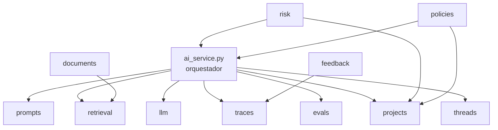

# Estructura del Proyecto

Este documento explica **qué hay en cada carpeta** del repositorio, qué
archivos son importantes y cuál es la responsabilidad de cada componente.

---

## Vista general

```
llm_ai_governance_project/
├── app/                          # Código de la aplicación FastAPI
│   ├── main.py
│   ├── core/                     # Configuración, logging, errores, auth
│   ├── api/                      # Routers y dependencias HTTP
│   ├── domain/                   # Lógica de negocio por dominio
│   ├── schemas/                  # Pydantic schemas de la API
│   ├── db/                       # Cliente Supabase + migraciones SQL
│   └── tests/                    # Suite de pytest
├── scripts/                      # CLIs para admins (seeds, exports)
├── docs/                         # Documentación + corpus normativo
├── notebooks/                    # Jupyter (fine-tuning workflow)
├── uploads/                      # Archivos subidos (gitignored)
├── Dockerfile
├── docker-compose.yml
├── requirements.txt
├── .env.example
└── README.md
```

---

## `app/` — Código de la aplicación

### `app/main.py`

Punto de entrada de FastAPI. Crea la app, registra middleware (CORS), monta
**9 routers** (uno por dominio expuesto), registra error handlers globales y
los hooks de startup/shutdown.

> Si añades un nuevo router, importarlo aquí y hacer `app.include_router(...)`.

### `app/core/` — Núcleo transversal

| Archivo | Responsabilidad |
|---|---|
| `config.py` | Lee `.env` con `pydantic-settings`. Expone el singleton `settings`. **Toda variable de entorno se lee aquí.** |
| `logging.py` | Configura el logger root + helper `get_logger(name)`. Output JSON en producción. |
| `security.py` | Verificación de tokens. **Hoy es un stub** — devuelve siempre `dev-tenant`. |
| `errors.py` | Jerarquía de excepciones (`AppError`, `NotFoundError`, `ValidationError`, `UpstreamError`, `TenantIsolationError`) + handlers FastAPI que las convierten en JSON. |

### `app/api/` — Capa HTTP

| Archivo | Responsabilidad |
|---|---|
| `deps.py` | Dependency injection: `get_db()` (cliente Supabase), `get_current_user()` (auth). |
| `routes/health.py` | `GET /health` |
| `routes/ai.py` | `POST /ai/query` — el endpoint estrella. Solo orquesta llamando a `AIService`. |
| `routes/documents.py` | Upload, process, list, get. |
| `routes/projects.py` | CRUD del expediente. |
| `routes/threads.py` | List, get, get-messages (no expone "send message"). |
| `routes/risk.py` | `intake` + `analyze`. |
| `routes/policies.py` | `generate` (con o sin proyecto) + `controls`. |
| `routes/prompts.py` | List, create (versionado de prompts). |
| `routes/feedback.py` | Submit feedback. |
| `routes/evals.py` | Get evaluation by trace_id. |

> **Convención:** los routers son **delgados**. Toda la lógica vive en
> `app/domain/<x>/service.py`. Esto facilita testear servicios sin levantar
> FastAPI.

### `app/domain/` — Lógica de negocio

Cada subdirectorio es un **dominio** (bounded context). Salvo `ai_service.py`,
ningún dominio importa de otro: solo `AIService` cruza dominios.

| Subdirectorio | Para qué sirve |
|---|---|
| `documents/` | Ingesta: upload, parsers (PDF/DOCX/TXT), chunking, embeddings. |
| `retrieval/` | RAG: búsqueda vectorial, query expansion, re-ranking. |
| `llm/` | Router OpenAI/Gemini + guardrails + clientes. |
| `prompts/` | CRUD de la biblioteca de prompts versionados. |
| `traces/` | Auditoría: persiste cada llamada al LLM. |
| `evals/` | Evaluación heurística automática de cada trace. |
| `feedback/` | Ratings 1-5 sobre traces. |
| `projects/` | Memoria L2: expediente del proyecto (perfil + riesgos + política). |
| `threads/` | Memoria L1: conversaciones persistentes. |
| `risk/` | Orquestador multi-step: entrevista de intake + análisis de riesgo. |
| `policies/` | Orquestador multi-step: generación de política y controles. |

#### Patrón estándar por dominio

```
app/domain/<x>/
├── __init__.py
├── models.py     # Pydantic models (records de DB + request/response)
└── service.py    # Clase XxxService(db) con la lógica
```

Algunos dominios tienen archivos extra (parsers, graders, etc.) pero el
patrón base es ese.

#### `ai_service.py` (caso especial)

Vive directamente en `app/domain/ai_service.py` (no en una subcarpeta) porque
es **el orquestador**: importa de `prompts`, `retrieval`, `llm`, `traces`,
`evals`, `projects`, `threads`. Es la única clase autorizada a cruzar
dominios.

### `app/schemas/` — Schemas Pydantic de la API

Separar `schemas` (lo que ve la API HTTP) de `domain/<x>/models.py` (lo que ve
la DB) permite evolucionar las dos capas independientemente.

| Archivo | Para qué |
|---|---|
| `ai.py` | `AIQueryRequest`, `AIQueryResponse`, `Citation`, `StructuredAnswer`. |
| `documents.py` | `DocumentUploadResponse`, `DocumentResponse`, `DocumentListResponse`, `DocumentProcessResponse`. |
| `feedback.py` | `FeedbackSubmitRequest`, `FeedbackResponse`. |
| `common.py` | Tipos compartidos. |

### `app/db/`

| Archivo | Responsabilidad |
|---|---|
| `supabase.py` | Singleton del cliente Supabase. `get_supabase_client()` devuelve la misma instancia siempre. |
| `migrations/` | Scripts SQL versionados (001..004). |

#### Migraciones SQL

| Migración | Qué agrega |
|---|---|
| `001_initial.sql` | Tablas base (`tenants`, `documents`, `document_chunks`, `prompts`, `traces`, `feedback`, `evaluations`) + extensiones `vector` y `uuid-ossp` + RPCs `match_chunks` / `match_global_chunks` + índices ivfflat. |
| `002_add_country.sql` | Columna `country` en `documents` y `document_chunks`. |
| `003_fix_ivfflat_probes.sql` | Ajusta `probes` del índice ivfflat para mejor recall. |
| `004_projects_memory_framework.sql` | `projects`, `threads`, `messages`. Agrega `framework` a `documents`/`document_chunks`. Sobreescribe los RPCs para aceptar `match_frameworks TEXT[]`. |

### `app/tests/` — Suite pytest

| Archivo | Cubre |
|---|---|
| `test_router.py` | LLM router + guardrails (detección de inyección, hardening). |
| `test_documents.py` | Upload + chunking + embeddings (mocked). |
| `test_ai.py` | Pipeline end-to-end con mocks completos (PromptService, RetrievalService, LLMRouter, etc.). |

---

## `scripts/` — CLIs operacionales

| Script | Para qué |
|---|---|
| `seed_prompts.py` | Carga los system prompts versionados (`chatbot`, `risk_intake`, `risk_analysis`, `policy_generation`, `controls_generation`, `executive_summary`) en la tabla `prompts`. **Idempotente.** |
| `seed_documents.py` | Carga masiva de documentos desde `docs/admin/<Framework>/<País>/...`. Mapea folder → `framework` slug. **Idempotente** salvo `--force`. |
| `backfill_embeddings.py` | Regenera embeddings de chunks existentes (útil al cambiar de modelo). |
| `export_finetune_data.py` | Exporta traces con feedback positivo a un `.jsonl` listo para fine-tuning de OpenAI. |

Todos se ejecutan con `PYTHONPATH=. python scripts/<x>.py`.

---

## `docs/` — Documentación + corpus

```
docs/
├── admin/                    # Corpus normativo (no incluido en git)
│   ├── ISO 42001/
│   ├── NIST/
│   ├── EU ACT/
│   ├── GDPR/
│   ├── OWASP/
│   ├── MITRE-ATLAS/
│   ├── PCI/
│   ├── Ciberseguridad/
│   ├── Gobierno Corporativo/
│   ├── Protección de Datos Personales/
│   └── LLMAll_en-US_FINAL.pdf  # framework-agnostic
├── api/                      # Documentación de endpoints
├── rag/                      # Pipeline RAG
├── decisions/                # ADRs y trade-offs
├── docker_deployment.md
├── testing.md
└── project_structure.md      # ← este archivo
```

### `docs/admin/` — Corpus normativo

Estructura:

```
docs/admin/<Framework>/<País>/archivo.{pdf,docx,txt}
```

- **Framework folder** → mapeado a un slug por
  `scripts/seed_documents.py:FRAMEWORK_FOLDER_MAP`. Ejemplos:
  `ISO 42001` → `iso_42001`, `NIST` → `nist_airmf`,
  `OWASP` → `owasp_llm_top10`.
- **País folder** → opcional. Sin él, el documento es global (aplica a todos
  los países).
- **Documentos directamente bajo `<Framework>/`** → framework-tagged, global.
- **Documentos directamente bajo `docs/admin/`** → framework=NULL,
  global (ej. `LLMAll_en-US_FINAL.pdf`).

> Los archivos del corpus **no** se commitean (son grandes y muchos tienen
> licencia restrictiva). Cada deploy debe sembrarlos con
> `seed_documents.py`.

---

## `notebooks/`

| Notebook | Para qué |
|---|---|
| `finetune_dataset_builder.ipynb` | Toma el `.jsonl` exportado por `export_finetune_data.py`, lo limpia, valida formato y lo deja listo para `openai api fine_tuning.jobs.create`. |

---

## `uploads/` (gitignored)

Directorio raíz para archivos subidos. Estructura:

```
uploads/
├── dev-tenant/
│   └── 8f2c1234..._archivo.pdf
├── global/
│   └── ...
└── <otro-tenant-id>/
```

En producción, montar como volumen o sustituir por S3.

---

## Archivos en la raíz

| Archivo | Para qué |
|---|---|
| `Dockerfile` | Multi-stage build para producción. |
| `docker-compose.yml` | Postgres con pgvector para desarrollo local. |
| `requirements.txt` | Dependencias Python (FastAPI, OpenAI, Supabase, etc.). |
| `.env` / `.env.example` | Configuración (gitignored / template). |
| `.python-version` | Pin de Python (3.11). |
| `.gitignore` | Excluye `.venv`, `.env`, `uploads/`, `__pycache__/`, `.pytest_cache/`, etc. |
| `README.md` | Onboarding y quickstart. |

---

## Diagrama de dependencias entre dominios



**Lectura:** `AIService` es la única clase con muchas flechas saliendo.
`RiskService` y `PoliciesService` reusan `AIService` internamente para sus
llamadas LLM. Cada otro servicio es independiente.

---

## Convenciones de código

- **Type hints siempre** — Python 3.11+, sintaxis moderna (`list[X]`,
  `X | None`).
- **Comentarios solo si explican el "por qué"**, no el "qué". Los headers
  de archivo grandes son intencionales para onboarding.
- **`from __future__ import annotations`** en módulos donde un método se
  llama `list` (para evitar shadow del builtin).
- **Snake_case** para todo Python. **PascalCase** para clases. **MAYÚSCULAS**
  para constantes a nivel módulo.
- **No imports circulares** — si te tientan, mover lo común a `core/` o
  `schemas/`.

---

## Ver también

- [README raíz](../README.md)
- [Decisiones de diseño](decisions/design_choices.md)
- [Pipeline RAG](rag/full_pipeline.md)
